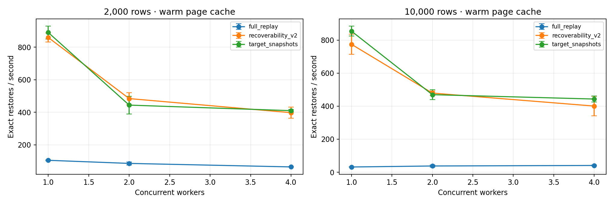
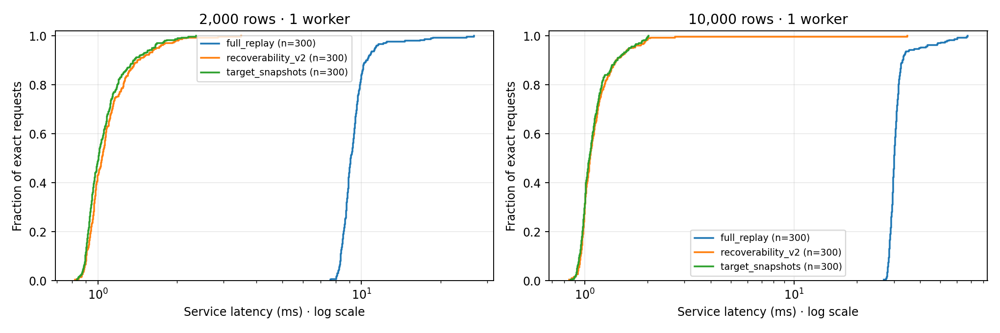

# RecoverML: Exact Artifact Time Travel for ML Pipelines under Declared Capability Loss

## Abstract

RecoverML selects the files needed to recover protected outputs from earlier machine learning pipeline versions when declared processing capabilities become unavailable. It records dependencies and physical file identities and minimizes retained bytes while preserving every required result under the specified losses. General exact formulations support alternative producers and cyclic histories, while an eligibility-checked minimum-cut route accelerates single-producer physical DAGs. Selected stores are checked and recovered files are verified against their original SHA-256 hashes. Experiments demonstrate specific storage and planning advantages over tested heuristics and faster native recovery at identical retained storage.

Time travel here means exact recovery of protected historical artifacts, including features, models and predictions. The guarantee assumes complete recorded dependencies, intact retained files and the supported replay environment.

The optional lossless encoded store preserves those canonical identities while selecting by actual encoded file lengths. It supports verified retained-file export and replay without a plaintext mirror.

## Method

1. **Capture:** record operations, inputs, parameters, implementation identities and output files, counting identical physical contents once.
2. **Declare preservation requirements:** identify mandatory roots, protected historical outputs and groups of processing capabilities that may be lost.
3. **Select:** minimize retained bytes using exact scenario or master/oracle optimization, or minimum cut when the graph passes the specialization guard.
4. **Check and recover:** validate the selection and its certificate, export retained targets or replay surviving producers, and verify exact target hashes.

The contribution is a checked retention and recovery system using established optimization methods. The algorithms and guarantee boundaries are described in the [DAG specialization](docs/TRACTABLE_SUBCLASS_OCT15.md), [contribution assessment](docs/CONTRIBUTION_POSITIONING_OCT16.md) and [comparison scope](docs/COMPARATOR_DECISION_OCT16.md).

## Results

The evidence includes the complete three-seed cloud studies published on 16 October 2026 and the planner-efficiency and broad recovery follow-ups on 26 October. Planning time, retained storage and recovery time are separate measurements.

| Evaluation | Measured result | Scope |
|---|---|---|
| Lossless encoded storage (26 October) | **71.83% median reduction** versus the raw exact frontier, at least **35.96% in all 216 conditions**; **9.80% median** versus strengthened gzip | Original hashes preserved; adaptive exact completes **504/504** requests. Same-codec manual optima still tie, and local search ties in 213/216 conditions. All 230 older transfer conditions remain visible, including Letter gaps. |
| Complete recovery census (26 October) | At least **1.10x faster than native DVC in 864/864 configurations**; median paired speedups **1.70x CLI / 48.32x warm API** | Six datasets, four recipe families, 72 captures; **7,776/7,776** exact method trials and **54,540** file-hash checks. Every fixed stratum passes the 90% gate. Finite authored catalogue; direct executor remains near parity. |
| Planner scaling update (26 October) | **7.82x faster** than previous RecoverML at 4,096 independent branches; **1.95x** for a wide retained frontier | Same exact optimum and checks; synthetic metadata controls. All 230 frozen conditions retain their minima; small-history timings are mostly flat and slower cases are retained. |
| Shared preprocessing loss | Less storage than strong local search in **9/36** cases, ties in 27, maximum reduction **48.74%** | All protected results remain recoverable; the manual optimal frontier matches every minimum |
| Separate preprocessing loss | Six storage wins and 30 ties against local search | Each winning difference is 129 serialized bytes |
| Cloud planning | Median paired speedups **11.92x / 16.88x** over local search and **2.28x / 1.73x** over scenario exact | Separate / shared loss respectively; exact minima agree across all 72 history-contract pairs |
| Native DVC recovery | RecoverML has lower median elapsed time in **36/36** histories; median paired speedups **2.19x** with recomputation and **9.91x** for retained targets | Identical optimal paid payloads, three paired trials, startup and verification included; all **12,096** target hash checks pass |
| Scientific fixed-budget matrix | **36,480** actual requests across 1,920 method-budget rows with zero unexpected outcomes | RecoverML completes 128/240 conditions, tying strong local search; individual partial recovery is a separate objective |
| Retinal processing-change study | **10,920 exact recoveries**, 90 snapshot-storage wins and 18 ties | Strong local search matches all 108 storage minima; separate physical code-retirement control recovers all 32 protected targets |
| Letter forest study | **3.6647 GB** of uncompressed canonical bytes saved, or **290.61 MB** with measured gzip, and **48/48 exact recoveries** | Preprocessing loss; strong heuristics match the savings, broader loss saves zero and snapshot loading is faster |

The shared-loss grid uses 36 constructed histories rather than 36 independent production workflows. The largest local-search storage gap is 131,793 bytes. The broad census measures the tested CLI and warm API integrations at equal optimal payload storage. Its 100% catalogue win rate does not establish a 90% production win probability or universal speed superiority. A direct executor is slightly faster overall and the manual frontier matches optimal storage.

Detailed evidence: [lossless storage](results/research/encoded_storage_oct26/RESULTS.md), [complete recovery census](results/research/recovery_census_oct26/RESULTS.md), [planner efficiency](results/research/planner_efficiency_oct26/RESULTS.md), [cloud storage and planning](results/research/strong_baseline_cloud_oct16/RESULTS.md), [earlier native DVC results](results/research/native_frontier_cloud_oct16/RESULTS.md), [scientific matrix](results/research/scientific_complete_oct16/RESULTS.md), [retinal study](results/research/eyeai_complete_oct15/RESULTS.md) and [Letter study](results/research/gigabyte_letter_oct16/RESULTS.md).

### Earlier concurrency control

The earlier prototype completed 5,400 exact requests across 54 trials and recorded timestamps, latency percentiles, throughput and CPU/RSS samples. The following figures belong to that earlier implementation, not the final native DVC integration. The [performance report](docs/reports/PERFORMANCE_REPORT.md) explains queueing and observed contention.





## Reproduction

The tested full runner uses **Python 3.12 on Linux**, including Ubuntu through WSL2 on Windows. The main planners and forest studies run on CPUs. Optional earlier PyTorch studies have a separate CPU dependency described in the [complete reproduction guide](reproducibility.txt).

```bash
git clone https://github.com/Hannaancode/RecoverML.git
cd RecoverML
python3.12 -m venv .venv
source .venv/bin/activate
python -m pip install -r requirements.txt
python -m pip install -e '.[paper]'
export OPENBLAS_NUM_THREADS=1
export OMP_NUM_THREADS=1
```

### Check the published evidence

```bash
python scripts/verify_release.py
python scripts/materialize_evidence.py
PYTHONPATH=src python -m recoverml.performance --audit-only --out results/milestone2/performance
PYTHONPATH=src python -m recoverml.audit results/milestone2/storage
```

The release verifier checks committed Git bytes and reconciles saved ledgers without retraining models. The materializer reconstructs the original retinal archive from its hash-checked transport parts. One original Letter archive container remains unavailable; its verified payload-equivalent reconstruction has a separate identity. The [release status](docs/RELEASE_STATUS_OCT16.md) describes this distinction. `python scripts/verify_release.py --require-complete` intentionally rejects that outstanding original-container gap.

### Run a fresh experiment

```bash
bash run_benchmarks.sh
```

This runs correctness tests, a storage smoke study and the earlier concurrency matrix over two data sizes, three policies, 1/2/4 workers and three repetitions. A new timestamped directory is created under `results/runs`; existing outputs are not overwritten.

The archived October 14 paper matrix has a separate runner:

```bash
bash scripts/run_paper_benchmarks.sh results/runs/paper_reproduction_01
```

The complete guide also covers fresh scientific and retinal and Letter studies, the three-runner cloud protocols, plotting from saved records, native DVC controls and strict archived-store replay. A fresh capture records its own environment; replaying an old store requires its original supported environment and source identities.

## Artifact contents

| Location | Contents |
|---|---|
| [src/recoverml](src/recoverml) | Capture, physical graph, retention planners, certificates and recovery |
| [tests](tests) | Correctness, failure-boundary and evidence-audit tests |
| [configs](configs) and [scripts](scripts) | Fixed study settings, automated runners and analyzers |
| [results/research](results/research) | Research protocols, raw ledgers, source snapshots, selected stores and plots |
| [results/milestone2](results/milestone2) and [results/archive](results/archive) | Earlier prototype and storage evidence |
| [results/validation](results/validation) | Dated audit receipts and validation logs |
| [docs](docs) | Technical design, literature comparisons, experiment protocols and reports |
| [paper](paper) and [output/pdf](output/pdf) | Dated manuscript checkpoints and PDFs |

The [artifact guide](docs/ARTIFACT_GUIDE.md) maps the main studies to their commands and evidence. The [results index](results/README.md) includes the earlier experiments. Repository manuscript files are dated checkpoints and should be read with the later result reports. `CHECKSUMS.json` and `CHECKSUMS_GITHUB.json` cover tracked regular files except the checksum manifests themselves; frozen source snapshots retain their original identities.

## Conclusion

RecoverML makes exact historical artifact preservation an explicit, checked storage-selection task. The evaluated shared-loss workflows expose storage choices missed by the tested local heuristic, and the guarded specialization and direct export path provide measured planning and recovery advantages. The evidence also records heuristic ties and representation and recovery-time tradeoffs, defining the scope of the demonstrated benefits.
