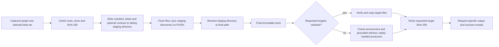

# RecoverML publication and recovery architecture

This diagram describes the implemented **single-filesystem** publication path in
`src/recoverml/store_publish.py` and the file API in
`src/recoverml/file_recovery.py`. One caller owns each destination. The final
store is immutable after publication, and callers give each recovery request a
separate output directory.

Only the final path is a readable store. The publisher uses a same-filesystem
rename after writing and syncing the staging contents. On POSIX, it syncs the
parent directory after rename. The contract is for process crashes, not power
loss during an uncompleted parent-directory sync.

```mermaid
stateDiagram-v2
    [*] --> FinalAbsent
    FinalAbsent --> Staging: create sibling staging directory
    Staging --> FinalAbsent: process exits before rename; staging may remain orphaned
    Staging --> FinalPresent: same-filesystem rename
    FinalPresent --> FinalPresent: independent read-only requests
    FinalPresent --> FinalPresent: later publisher fails existing-path check
```

The two recovery routes share the captured target hashes but have different
execution guards. The retained-file route verifies source and destination
bytes and does not deserialize a model. The replay route checks the saved
environment by default, constructs a grounded witness from the final store,
executes only required producers, and checks each reconstructed blob before
writing the requested target files. A failed or interrupted request has no
success receipt; any request-specific partial output must be discarded.

| Invariant | Enforced by | Executable evidence |
|---|---|---|
| A selected store includes all mandatory roots and only known blobs | `publish_store` checks selected IDs, lengths and hashes | `tests/test_store_publication.py`; `verify_published_store` checks the final inventory |
| Readers see either no final path or the renamed complete store after a process crash | sibling staging directory, same-filesystem rename, final-path-only reader contract | before/after `os._exit(47)` child-process checks in `tests/test_store_publication.py` |
| One reader cannot overwrite another reader's output when callers use different directories | request-specific output directories and restorer instances | 32 requests through an 8-worker pool in `tests/test_store_publication.py` |
| Every successful requested file has its captured SHA-256 | retained-file export and witness replay checks | file API trials and raw target hashes in `results/research/runtime_scaling_oct30/evidence.zip` |

The concurrency and crash claims require one publisher per destination, a
single local filesystem for publication, and readers that open only the final
path. The independent-runner capacity study uses separately published stores;
it does not test a shared distributed store, network routing, or distributed
crash consistency.
