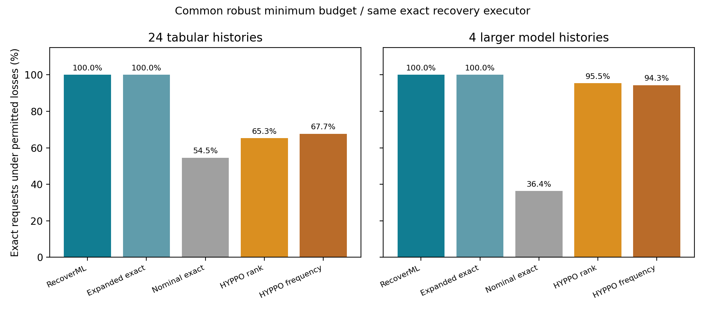
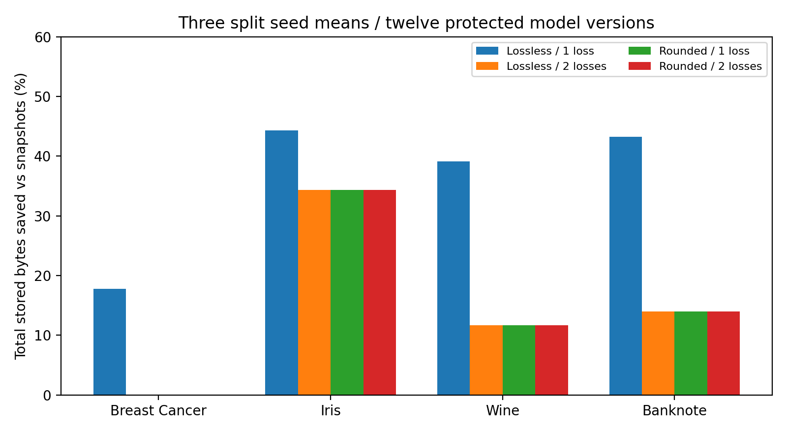
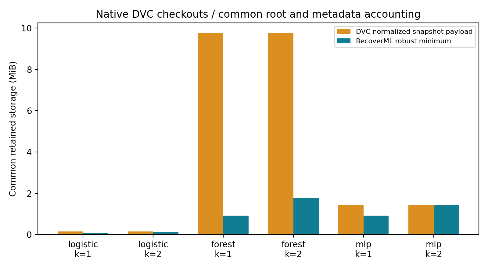
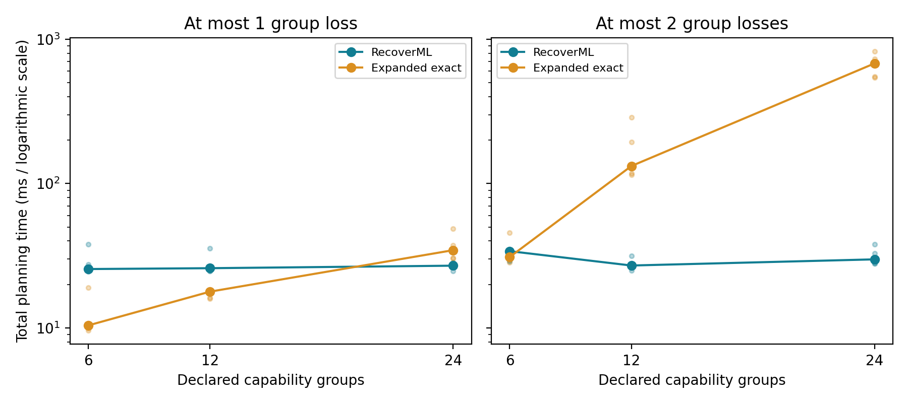
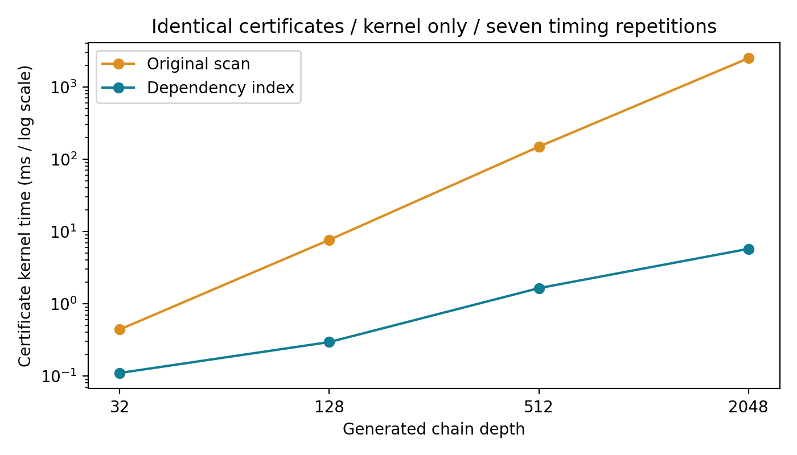
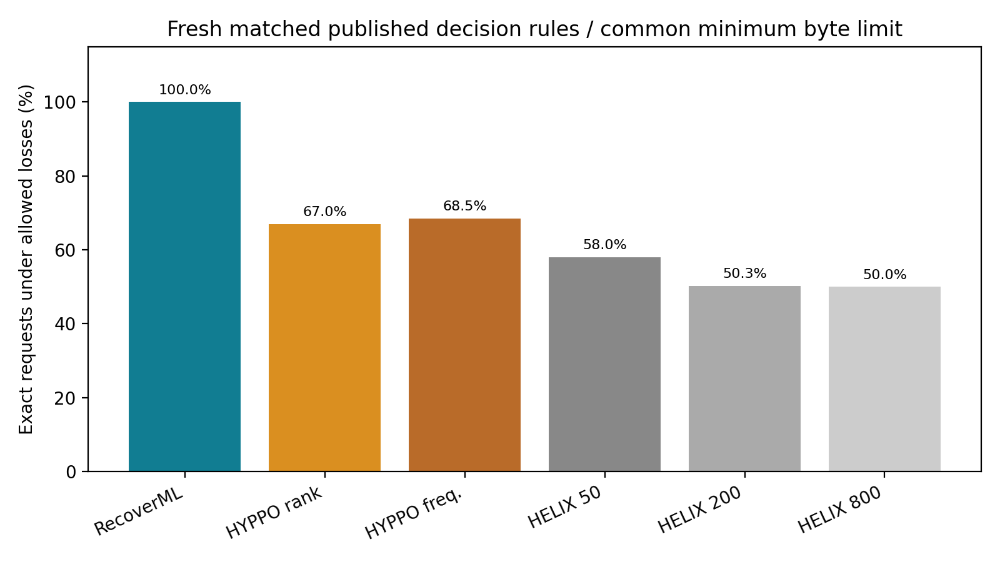
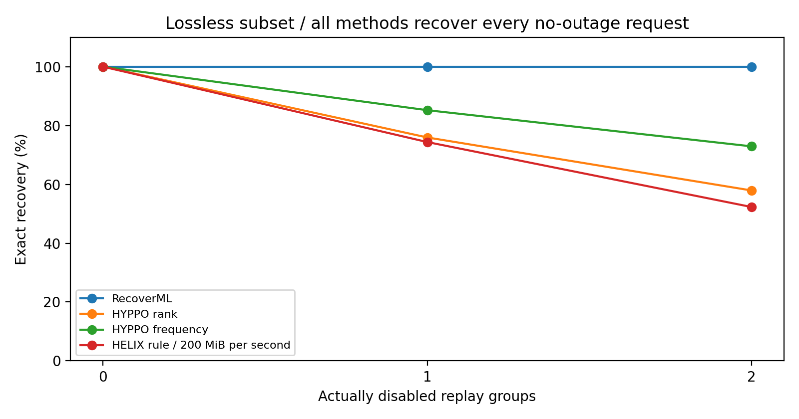
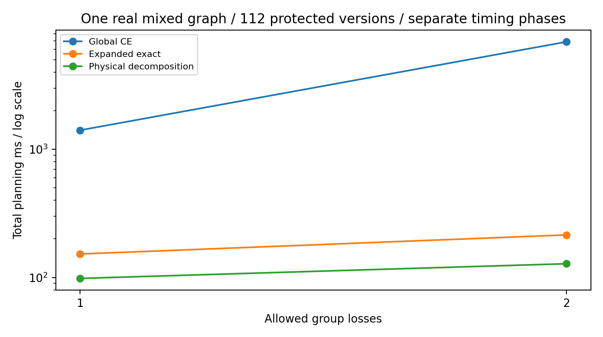
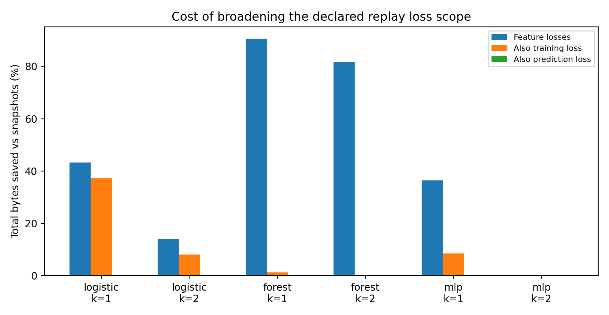

## Abstract

Historical machine learning artifacts share inputs and intermediate results but removing too much can make exact recovery depend on replay tools that later disappear. We study minimum shared physical storage for historical model and prediction recovery after any loss of at most k declared correlated replay capability groups. RecoverML uses captured byte identities and a universal recovery contract and certifies the byte minimum through exact physical decomposition and local scenario or closed set optimization. The decomposition remains exact when components share loss labels and grounded certificates handle physical alias cycles. An initial 48 case tabular study agrees with an independent exact formulation in every case and saves 20.26 percent of total bytes relative to target snapshots. A fresh 56 case published decision rule comparison restores all 3344 RecoverML requests while unchanged HYPPO components restore 2240 and 2291 and the best tested common budget HELIX rule setting restores 1940. All tested methods recover all no outage requests in the lossless subset. A shared graph protects 112 versions and saves 93.50 and 83.94 percent versus snapshots under one and two preprocessing replay group losses. Native DVC checkouts and trained forest and neural artifacts and layered AND controls and broader fitting and prediction outage controls define the storage and compute tradeoff. The proposed contribution is a precise historical retention contract and certified physical optimizer with reproducible system evidence.

## 1 Introduction

A machine learning workflow produces several kinds of derived data including fitted preprocessing state and transformed features and trained models and prediction arrays. These artifacts resemble materialized results in a database because keeping a result avoids later computation while deleting it saves persistent storage. Across several historical versions much of the upstream data can be shared. The relevant storage decision therefore concerns a set of histories rather than one isolated model file.

Ordinary replay assumes that the required computation path remains usable. That assumption can fail when a preprocessing interface is retired or an external transformation cannot be called again. Retaining all historical outputs removes that dependence but may retain much more data than needed. A useful intermediate contract is to prepare for any loss of a bounded number of specified replay capabilities and to select one shared store that protects every requested historical output under that contract.

Consider a lossless feature export that has the same captured bytes as two recorded local scaling implementations. If only one scaling capability may become unavailable the fitted scaler state and membership checkpoint may suffice because the other implementation can still rebuild the features. If both implementations may disappear the planner must instead keep a larger intermediate artifact or the outputs themselves. A rounded feature export may have no exact alternative and should not receive the same recovery treatment merely because its values are numerically close.

RecoverML addresses this choice explicitly. It treats capability loss as a restriction on which recorded producers may execute and treats stored artifacts as intact. The logical dependency graph remains unchanged while physical identities allow several producers to supply one artifact. This distinction can introduce cycles in the physical graph even when the logical capture graph is acyclic and therefore a solver must not mistake a cycle for a source of data.

We make three contributions.

1. **A minimum storage recovery contract.** We define one physical retention set protecting multiple historical ML outputs after every loss set of at most k correlated replay capability groups and count mandatory inputs and manifest and capability contract bytes.
2. **An exact physical decomposition and certified optimizer.** Fixing mandatory roots separates physical retention decisions even when the smaller problems share failure labels. A rooted provider reduction and local exact engines preserve the global byte minimum while an indexed executor preserves grounded recovery certificates.
3. **A reproducible study of the price of resilience.** We compare against an independent exact formulation and original HYPPO materialization components and native DVC snapshots and include public datasets and larger trained artifacts and rounded data controls and exhaustive small graph checks and analytic scaling families.

These contributions concern the stated retention problem and implementation. We do not claim to invent materialization or equivalent computation paths or robust optimization or counterexample guided synthesis and we do not claim that a failed search proves the absence of all overlapping work.

## 2 Related work and research boundary

HELIX optimizes reuse and materialization for iterative ML workflows and establishes the importance of deciding when to load or compute derived artifacts [1]. HYPPO explicitly represents equivalent tasks and artifacts and alternative hypergraph plans and materializes artifacts to reduce future execution cost [2]. Thus neither an artifact dependency graph nor an alternate producer is an original contribution of this paper. Our constraint requires every protected historical target to remain reachable under every permitted capability loss set and our objective is total retained bytes rather than expected future execution cost.

Kishu provides notebook state time travel with exact restoration for serializable state and recomputation boundaries [3]. ExoFlow provides exactly once recovery for distributed DAGs with explicit task semantics and checkpoint boundaries [4]. These systems motivate historical recovery and replay contracts but operate at different state and execution layers. RecoverML protects captured artifact values and does not reproduce wall clock events or provide transactional notebook rollback or exactly once distributed side effects.

CHEX already shares common computations across application versions and chooses replay order and checkpoint cache decisions to reduce multiversion replay time [14]. Historical sharing and multiversion replay are therefore also established ideas. Our loss quantified persistent retention contract differs from choosing an in memory checkpoint and restore sequence for currently executable application versions. We cite CHEX as closely related work and do not claim an executed comparison against it.

Content addressed derivations in Nix and provenance based storage versus recomputation already establish output identity and reuse across computations [5,6]. The current system uses captured output hashes as verified witnesses and does not infer algebraic equivalence or promise that two operators agree on uncaptured future inputs.

The closed set representation rests on established Horn implication and directed hypergraph cut ideas [7]. Group loss resembles minimum label cuts because removing one label can disable several producer edges [8]. Counterexample guided checkpoint generation also predates this work in secure biochip monitoring [9]. We instantiate these ideas for byte weighted physical retention with multiple historical targets and prove the validity of complement storage cuts and the optimality condition for our master and adversary loop.

FTOpt chooses fault tolerance strategies for parallel queries to improve expected processing time under failures [10]. Checkmate schedules tensor rematerialization under a training memory budget [11]. Our problem concerns persistent historical artifacts and a worst case bounded capability contract. It does not optimize restart makespan or GPU activation memory or a probability weighted failure objective.

DVC provides native cached snapshot restoration and pipeline reproduction [12]. We execute its snapshot checkout path as a concrete storage baseline and do not equate that experiment with all capabilities of DVC. Similarly our HYPPO experiment executes a pinned released materialization component through a disclosed adapter and is not an end to end measurement of the complete HYPPO system.

Fault tolerant minimum cost source placement also predates this study. Sakashita and colleagues optimize source locations under flow and connectivity requirements [15]. Our distinction is conjunctive producer dependencies and bounded globally correlated replay labels and captured byte aliases for exact historical ML targets. Generic source placement and graph decomposition and provider counting are prior ideas and our contribution is the stated contract and exactness arguments and verified system. A selected source review cannot prove absence of every equivalent formulation.

## 3 Model and system

### 3.1 Logical provenance and physical identity

A capture graph contains nodes for deterministic operations and non replayable outputs and records each operation's dependency node IDs and parameters and output hash and serialized size and replay flag. The graph records source and environment identities. Requested historical versions name model and prediction nodes. Different logical nodes may have the same captured output hash and therefore refer to one physical artifact.

Let B be the finite physical artifact set and R the mandatory retained roots and T the union of protected target artifacts. Each replayable producer p has a distinct dependency artifact set D(p) and output o(p). It may carry one capability group c(p). Several producers may share a group and several producers may produce the same physical output. The original capture archive is a validation oracle outside the executor and is never an available recovery source.

The numerical environment and recorded recipes must match capture and every surviving producer must satisfy its declared deterministic replay contract. SHA 256 establishes the captured artifact identity under the usual collision resistance assumption and every loaded or rebuilt value is checked against that identity. Hash equality refers to captured serialization bytes and not merely similar predictions.

### 3.2 Capability contract

Let C be the declared capability groups and let F be a disabled subset. Producers whose group belongs to F are unavailable while ungrouped producers remain available. Stored files remain intact. For retained set S define L(S,F) as the least closure starting from S and repeatedly applying available producers whose complete dependency artifacts are already present.

The contract is

$$R\subseteq S\subseteq B\quad\text{and}\quad T\subseteq L(S,F)\ \text{for every }F\subseteq C\text{ with }|F|\leq k.$$

The objective is

$$\min_S\left(m+h+\sum_{b\in S}s_b\right)$$

where m is the original manifest size and h is the capability contract size and s_b is the actual serialized artifact size. Metadata and mandatory inputs are paid by every comparator. A byte budget can additionally bound this total. A loss count is a bound on declared groups and not a statistical claim about real infrastructure failure frequency.

In our dual scaler workload the groups are membership generation and scikit learn preprocessing and NumPy scaling. The scikit learn group includes both fitting and its transform operation so one loss disables both calls. These are injected replay call availability restrictions and do not uninstall numerical libraries. The two scaler implementations share underlying libraries and are not independent package or machine failure domains. Training and prediction and file decoding remain available in this experiment.

### 3.3 Complexity and grounding

The retention problem is NP hard even for k equal to zero. Reduce weighted set cover by creating one non replayable selectable artifact for every set and one target for every universe element. For each membership create a producer from that set artifact to the element target. Give every target a storage cost larger than the sum of all set costs. Retaining all set artifacts is cheaper than retaining a target so an optimum retains only a covering collection of set artifacts and its storage objective solves weighted set cover. Fixed metadata and a mandatory dummy root do not change the reduction. This is a property of the declared dependency model and not a claim of a polynomial time algorithm.

Physical aliases can create a self loop or a larger cycle even though logical capture is a DAG. Such a cycle cannot supply a missing initial artifact. All recovery reasoning therefore uses a least grounded closure and the executor never accepts a derivation solely because its dependencies occur somewhere in a cycle.

## 4 Exact retention and grounded recovery

### 4.1 Storage master

The master has one binary retention variable x_b for each physical artifact and fixes x_b to one for roots. Initially it minimizes the byte objective without robustness constraints. When an adversary finds a breaking loss it adds a necessary storage inequality and the master is solved again. No replay variables or loss scenario copies are stored in this master.

### 4.2 Closed set adversary

For a candidate retained set S the adversary has binary artifact membership variables y_b and group loss variables f_c. It requires every retained artifact to belong to a closed set A and at least one protected target to be absent and at most k group losses. For each grouped producer it adds

$$y_{o(p)}-\sum_{d\in D(p)}y_d+f_{c(p)}\geq1-|D(p)|.$$

The f term is omitted for an ungrouped producer. This is the implication that when a producer is available and all its inputs belong to A its output also belongs to A. If an input and output share the same physical identity their coefficients accumulate rather than being silently overwritten.

The adversary minimizes the number of losses and then maximizes the size of A. With N artifacts an objective coefficient of N plus one for each loss and minus one for each membership implements that lexicographic order. Maximizing A makes the complement cut smaller and often strengthens the next master problem. This choice improves the returned cut but is not required for its validity.

**Proposition 1: adversary equivalence.** A breaking allowed loss exists exactly when the adversary has a feasible closed set.

**Proof.** If L(S,F) misses a target then that least closure is a feasible closed set. Conversely every closed set containing S contains L(S,F) because closure can only add an output when its inputs are already present. Thus if A misses a target the least closure also misses it. This argument does not require an acyclic physical alias graph.

### 4.3 Necessary cuts and certified optimum

For a counterexample A under loss F add

$$\sum_{b\in B\setminus A}x_b\geq1.$$

**Proposition 2: cut validity.** Every robust retention set satisfies this inequality.

**Proof.** A retained set contained in A has a closure contained in A under the same loss F and therefore misses the target. Every robust set must retain something outside A.

The implementation checks the returned closed set and bounded loss and retained inclusion and missing target and independently reconstructs grounded reachability before adding a cut.

**Proposition 3: certified termination.** If the master returns a proven minimum and the adversary proves infeasibility then the selected store is a robust byte optimum within the encoded model and solver tolerances.

**Proof.** Every added cut is necessary so the proven master optimum is a lower bound on all robust stores. Adversary infeasibility makes the current store robust and it meets that lower bound. Each valid cut excludes the current non robust store so unrestricted exact execution cannot revisit that store. There are finitely many physical retention subsets and the full store is feasible when all protected target files are intact.

Solver timeouts and iteration limits return an unknown result and do not establish either robustness or optimality. An incumbent counterexample may still give a valid cut after independent checks but a feasible incumbent alone is not a universal robustness certificate.

### 4.4 Indexed recovery certificates

The executor begins with retained artifacts and records grounded producer choices in rounds. The original implementation scans every producer in every round and chooses the first eligible producer in sorted capture cost and node ID order. The new implementation indexes each missing dependency artifact to its consumer producers and maintains a missing input counter for every producer.

Only consumers of newly grounded artifacts have their counters decreased. A producer whose counter reaches zero enters the next round's priority queue. Producers that refer to already available outputs are skipped. Deferring new eligibility to the next round preserves the original wavefront and sorted producer ordering.

**Proposition 4: certificate preservation.** The indexed implementation returns the same available artifacts and producer choices and round numbers as the scanning implementation for every retained set.

**Proof.** Both start with the same retained set. Inductively a producer is ready in a round exactly when all dependencies were available before that round. The counter index expresses the same condition and the priority queue visits the same eligible producers in the same order. Output alias suppression therefore makes the same choice and both obtain the same next frontier.

The scanning kernel can require O(P times H) dependency checks for P producers and H grounding rounds. The index processes each recorded distinct producer dependency at most once and each producer enters the queue at most once so its work is O(P plus E plus P log P) and its additional memory is O(P plus E). These are certificate construction bounds and do not remove the optimizer's exponential worst case or guarantee a full restoration speedup.

### 4.5 Artifact encoding

Arrays use recorded numerical values and supported tree and linear estimators use a canonical numerical state codec. The larger neural experiment exposed a Python pickle round trip that did not preserve the serialized model identity. We therefore capture a canonical inference checkpoint containing model parameters and fitted weights and classes and label encoding state and verify exact inference against the native trained model before capture completes. This checkpoint preserves inference and its captured bytes and is not an optimizer checkpoint for resuming training. Source hashes guard the extension implementation and are checked during replay.

### 4.6 Root conditioned physical decomposition

Build an undirected graph on optional physical artifacts B minus R. For every replayable producer with an optional output connect that output to every optional dependency. Opaque provenance edges and producers of fixed roots do not enter this executable connectivity graph. Each captured physical alias remains one vertex. Components with no protected target need no optional retention because no executable dependency crosses to another optional component.

**Proposition 5: exact decomposition despite shared labels.** The global optional byte minimum equals the sum of local component minima with the same loss bound k even when a replay capability group labels producers in several components. Original metadata and mandatory roots are paid once.

**Proof.** After fixing roots every available producer with an optional output has its optional dependencies in the same component. Grounded closure therefore separates the target availability predicates by component. If C_i contains the groups used in a component each allowed global loss restricts to a local loss set of size at most k. Conversely any local loss set of size at most k extends to an allowed global set by losing no other groups. Universal recovery over global losses and components is thus equivalent to the separate universal local contracts. Shared labels do not couple retention decisions under those universal quantifiers and optional byte costs add. Shared optional artifacts do couple decisions and are kept in one physical component.

Internal solver projections contain the component's logical aliases and needed roots and targets and local groups. Opaque ancestry does not become an executable dependency and these projections never replace the published capture manifest. Recombined stores retain the original global manifest and capability contract.

**Proposition 6: rooted provider reduction.** For a singleton optional component containing a protected artifact no retention is needed exactly when an ungrouped rooted producer exists or more than k distinct rooted producer groups exist. Otherwise that artifact must be retained.

**Proof.** A rooted producer needs only mandatory artifacts. More than k distinct groups cannot all be lost under the contract. If no ungrouped producer exists and at most k rooted groups exist a valid loss disables all of them. A self alias requiring the missing artifact cannot ground it and provides no independent source. The target itself is then the only optional stored source and is required.

For larger components an engineering selector uses scenario expansion for at most 64 local loss scenarios and the closed set engine otherwise. The cutoff was calibrated on the initial provider study before testing new group counts and widths. It is not a fastest engine oracle and exactness depends on certification by the selected engine rather than this cutoff. Unknown solver results do not certify decomposition.

## 5 Experimental method

### 5.1 Workloads and independence

The main tabular matrix captures Breast Cancer and Iris and Wine and UCI Banknote Authentication data [13]. Each dataset has three split seeds and both lossless NumPy import and six digit CSV import and twelve historical logistic model versions. These choices yield 24 captured histories and 48 cases after applying loss bounds one and two. Every allowed loss set is evaluated for every protected historical version. The legacy import is unavailable after capture and the alternate scaler operations execute independently and their output hashes are compared without copying the legacy output into an alternate producer.

The rounded CSV cases are a negative control for exact identity. The twelve versions vary the logistic regularization parameter and share their upstream inputs. Several versions and outage requests from one captured history are therefore repeated measurements of a shared workflow and are not independent data samples. Reported coverage counts are exhaustive for the declared three group universe. Descriptive means do not estimate the prevalence of useful alternate producers in production.

The larger payload matrix uses the real Digits data with trained random forests and a two hidden layer CPU neural classifier. The neural layers have 96 and 32 units and fitting uses a fixed seed and a maximum of 60 LBFGS iterations. Accuracy checks establish that these are working learned artifacts and are not improvements in classifier quality. Detailed counts and byte totals appear in the generated evidence tables below.

### 5.2 Comparators and fairness

**Nominal exact retention** minimizes bytes without outages. **Full target snapshots** retain roots and every protected output. **All groups unavailable exact retention** minimizes storage with every declared replay group disabled and provides a stronger conservative baseline than full snapshots.

**Scenario expanded exact retention** independently gives each allowed loss scenario artifact availability and replay choices and continuous topological ranks while sharing global storage variables. It has the same byte objective and root and target and metadata contract. Ranks prohibit self supporting cycles. The resulting store is independently checked under every enumerated loss and all proven byte optima are compared with RecoverML.

**HYPPO released materialization components** execute unmodified history_manager.py at the pinned revision and source hash below [2]. We run both rank and frequency weighted functions. The adapter supplies physical artifacts and maximum captured logical ancestry compute estimates and per version dependency access counts. Every optional artifact including membership and alternate identities is eligible. These are adapter annotations and not the complete HYPPO hyperpath cost estimator or execution system.

```text
Revision 405e42de863272fcb71a625cf6b2ae0696c7a8c5
SHA256   b857a387b81127585cb19a5925f1b1a84ed63361db5184ea3c84f8adc864765a
```

The released component uses a strict integer capacity inequality. Passing the optional budget plus one makes that inequality equivalent to the inclusive budget used by every other policy and a separate post check prevents any extra usable byte. The initial strict capacity protocol pilot is preserved and is excluded from the final comparison. The corrected comparison uses both the robust minimum budget and a larger full snapshot budget. HYPPO and nominal policies are given the same grounded alternative producer executor so a recovery difference reflects retention choices rather than a stronger executor reserved for our method.

**Native DVC snapshots** use DVC 3.67.1 with a shared root snapshot and a separate checkpoint directory for every historical version. The benchmark actually adds files to the DVC cache and deletes each checkpoint workspace and runs dvc checkout and verifies every restored target hash. It separates native cache directory and pointer metadata from a common normalized byte total so differences in system metadata do not create artificial payload savings. This comparison characterizes immutable snapshot retention and not DVC pipeline reproduction or an end to end speed competition.

Snapshot and all groups unavailable policies may use more than the robust minimum budget and their complete recovery is reported at their own storage points. They are not counted as admitted policies under a smaller budget. The two exact robust formulations and the small budget HYPPO policies are direct common budget comparisons.

**HELIX Streaming OMP** is our documented reimplementation of published Algorithm 2 and Definition 6 [1]. We replay the captured logical DAG schedule and evaluate a node when every child has completed. The rule saves it if its cumulative compute cost exceeds twice its load estimate and the remaining inclusive byte budget permits it. Logical ancestors are counted once and load time equals serialized size divided by read speed. Physical aliases share payload storage. The fresh study declares 50 and 200 and 800 MiB per second and both orders within an out of scope event before inspecting results. This is a published decision rule with our identity and schedule adapter and not native HELIX or its full iterative eviction system. Main rows receive the robust byte limit and an extra control receives the snapshot limit.

### 5.3 Measurements and correctness

Each recovery creates a fresh disk graph and executor and checks model and prediction bytes against the capture oracle outside the executor. Expected structural failures are recorded rather than discarded and any unexpected hash mismatch aborts the experiment. Traces include start and end timestamps and process CPU work and operation events and an assertion that the disk graph has no capture archive. Actual selected store bytes must equal the reported artifact and metadata total.

Request timings measure the version execution call after graph loading and executor construction and should not be interpreted as complete client latency. Planner scaling measures construction plus solving plus post checks and rotates formulation order. Kernel timings rotate certificate implementation order. Timing repetitions on one host do not constitute independent workflow or machine samples.

Independent correctness checks enumerate physical storage subsets and allowed loss sets on small generated logical graphs with aliases and cycles and compare reachability through a recursive path oracle. The indexed certificate is compared with the old implementation including complete step ordering. Generated larger provider graphs have an independently derived minimum: targets with at most k distinct direct providers must be retained and those with at least k plus one providers remain derivable from roots. Every provider group participates in protected derivations.

The large universe control with 96 groups and k equal to three has 147537 possible loss subsets. Its coverage is symbolically certified and analytically checked while selected disk probes are executed. This number is not an executed request count. We preserve the earlier three version pilot where snapshot savings are zero so increasing history length or introducing alternatives is not presented as a universal gain.

## 6 Results

### 6.1 Tabular exact recovery and storage

The corrected tabular matrix contains 28512 genuine requests across nine policies and 24516 exact outcomes and 3996 expected blocked outcomes. The proposed method and the independent expanded formulation each recover 3168 of 3168 requests and have identical proven byte minima in all 48 cases. Full target snapshots and all groups unavailable stores also recover every request at their larger storage points. Nominal retention recovers 1728 of 3168 requests.

The rank based HYPPO component recovers 2069 of 3168 requests at the robust minimum budget and the frequency weighted component recovers 2145. With the larger snapshot budget these counts increase to 3013 and 2889. These results show that optimizing estimated reuse benefit does not enforce the stated historical outage contract under this adapter. They do not show general inferiority of HYPPO for its intended pipeline cost objective.

The robust store averages 20.26 percent fewer total bytes than full target snapshots and the conservative all groups unavailable optimum averages 14.98 percent fewer. HYPPO may retain slightly fewer bytes than the robust store while failing more requests because a lower used byte total alone does not establish the required recovery coverage.

Lossless Banknote features with a one group loss bound reproduce the earlier 43.24 percent snapshot saving and the lossless Iris condition saves 44.34 percent. With two allowed losses or rounded features the planner often selects a larger store. Breast Cancer has zero snapshot saving for the two loss bound and rounded conditions. The full condition table is generated from the saved summaries.

### Verified comparison tables

\needspace{11\baselineskip}

| Policy | Tabular exact requests | Larger model exact requests |
|---|---:|---:|
| RecoverML | 3168/3168 | 176/176 |
| Expanded exact | 3168/3168 | 176/176 |
| Nominal exact | 1728/3168 | 64/176 |
| HYPPO rank | 2069/3168 | 168/176 |
| HYPPO frequency | 2145/3168 | 166/176 |



\needspace{10\baselineskip}

| Dataset | Lossless k=1 saving | Lossless k=2 saving | Rounded k=1 saving | Rounded k=2 saving |
|---|---:|---:|---:|---:|
| breast cancer | 17.75% | 0.00% | 0.00% | 0.00% |
| iris | 44.34% | 34.34% | 34.34% | 34.34% |
| wine | 39.09% | 11.64% | 11.63% | 11.63% |
| banknote | 43.24% | 13.96% | 13.96% | 13.96% |



### Larger trained artifacts

The corrected Digits experiment contains 4 histories and 8 planning cases and 1584 requests across nine policies and the robust and expanded exact methods each recover 176 of 176 requests. Forests use 24 to 48 trees and depth at most twelve and the neural model uses 96 and 32 hidden units. Held out forest accuracies range from 95.56 to 97.33 percent and neural accuracies range from 96.89 to 97.11 percent. These are workload checks and not classification improvements.

\needspace{10\baselineskip}

| Estimator | Bound | Snapshot saving | Robust exact requests |
|---|---:|---:|---:|
| forest | 1 | 90.63% | 32/32 |
| forest | 2 | 81.65% | 56/56 |
| mlp | 1 | 36.36% | 32/32 |
| mlp | 2 | 0.00% | 56/56 |

### Native DVC snapshot comparison

The native DVC experiment completes 40 real per version checkouts across 6 separately captured history configurations and checks every restored model and prediction hash. The following means use two seeds and include common roots and manifest and contract bytes while DVC specific directory and pointer bytes are recorded separately.

\needspace{12\baselineskip}

| Workload | Bound | Normalized DVC snapshot bytes | RecoverML bytes | Saving |
|---|---:|---:|---:|---:|
| logistic | 1 | 149614 | 84914 | 43.24% |
| logistic | 2 | 149614 | 128730 | 13.96% |
| forest | 1 | 10241524 | 959842 | 90.63% |
| forest | 2 | 10241524 | 1878866 | 81.65% |
| mlp | 1 | 1508949 | 960343 | 36.36% |
| mlp | 2 | 1508949 | 1508949 | 0.00% |



### Exact planning scalability

All 60 planner executions match the independently derived byte minimum. Timing repetitions per formulation and case rotate the solve order and the times include formulation construction and solving and post checks. These are same host repeated timings rather than independent machine samples.

\needspace{12\baselineskip}

| Groups | Bound | RecoverML median ms | Expanded median ms | Expanded / RecoverML |
|---|---:|---:|---:|---:|
| 6 | 1 | 25.58 | 10.41 | 0.41 |
| 6 | 2 | 34.03 | 31.00 | 0.91 |
| 12 | 1 | 25.94 | 17.84 | 0.69 |
| 12 | 2 | 27.07 | 132.28 | 4.89 |
| 24 | 1 | 26.99 | 34.57 | 1.28 |
| 24 | 2 | 29.86 | 680.10 | 22.78 |



At 24 groups and two losses the expanded model has 27255 variables while the storage master has seventeen and the adversary has forty one. The master and adversary are solved iteratively and these counts should not be interpreted as a single seventeen variable full optimization. Enumeration is faster in the smallest cases and the proposed advantage emerges as the scenario universe grows.

### Indexed certificate kernel

\needspace{10\baselineskip}

| Generated depth | Scan median ms | Index median ms | Kernel speedup |
|---|---:|---:|---:|
| 32 | 0.439 | 0.110 | 4.00 |
| 128 | 7.631 | 0.294 | 25.98 |
| 512 | 148.777 | 1.638 | 90.81 |
| 2048 | 2493.473 | 5.734 | 434.89 |



All 56 kernel timings preserve the complete certificate including producer choices and grounding rounds. The generated dependency chain result measures certificate construction only and is not a claim of the same speedup for a full model recovery request.


### 6.2 Interpretation of the comparison

The benefit follows from sharing protected histories and exploiting only verified alternative identities while using the outage bound in retention decisions. A conservative policy prepares for losing every tool even when the contract allows only one loss and can therefore retain an unnecessarily large feature artifact. A nominal policy or reuse benefit heuristic can omit a cheap membership or fitted state checkpoint because it does not evaluate the adversarial loss sets. RecoverML imposes the recovery requirement before selecting the minimum byte store.

Forcing a stronger recovery contract can eliminate some storage advantage and keeping small recipes can require more computation during recovery. Full snapshots naturally favor cheap reads and a byte minimizing policy may retrain models. We therefore do not infer lower restoration latency from lower storage or claim a universal performance advantage. The separate formulation and kernel studies identify the computational settings where the new implementation helps and where expanded enumeration remains competitive.

### Final published method comparison

The fresh matrix captures 28 histories and 56 bound cases and records 33440 real requests. Every main method has the same robust byte limit and exact recovery executor. HYPPO runs unchanged released ranking functions while HELIX is a documented reimplementation of Algorithm 2 and Definition 6 with disk speeds 50 and 200 and 800 MiB per second and both out of scope tie orders. These are decision rule comparisons and not native full system runtime comparisons.

\needspace{16\baselineskip}

| Policy | Exact | Requests |
|---|---:|---:|
| HELIX 200MiB capture | 1681 | 3344 |
| HELIX 200MiB reverse | 1681 | 3344 |
| HELIX 50MiB capture | 1940 | 3344 |
| HELIX 50MiB reverse | 1940 | 3344 |
| HELIX 800MiB capture | 1673 | 3344 |
| HELIX 800MiB reverse | 1673 | 3344 |
| HELIX snapshot budget | 2437 | 3344 |
| HYPPO frequency | 2291 | 3344 |
| HYPPO rank | 2240 | 3344 |
| RecoverML decomposed | 3344 | 3344 |



The HELIX snapshot budget row has the larger snapshot limit and is reported separately. The lossless subset below isolates actual outages because every main method recovers every no outage request. Rounded imports can additionally expose a difference between protecting all old targets and optimizing future reuse.

\needspace{12\baselineskip}

| Policy | No outage | One disabled group | Two disabled groups |
|---|---:|---:|---:|
| RecoverML decomposed | 320/320 | 960/960 | 480/480 |
| HYPPO rank | 320/320 | 729/960 | 278/480 |
| HYPPO frequency | 320/320 | 818/960 | 350/480 |
| HELIX 50MiB capture | 320/320 | 722/960 | 271/480 |
| HELIX 200MiB capture | 320/320 | 714/960 | 251/480 |
| HELIX 800MiB capture | 320/320 | 710/960 | 247/480 |



### Shared history and physical decomposition

One graph combines 12 branches and 112 historical versions. Both original exact engines agree on both byte minima and complete 2464 exact disk requests. Ten component runs match those minima.

\needspace{8\baselineskip}

| Bound | Snapshot bytes | Minimum bytes | Saving | CE ms | Expanded ms | Decomposed ms |
|---|---:|---:|---:|---:|---:|---:|
| 1 | 21376829 | 1390318 | 93.50% | 1408.24 | 152.44 | 98.31 |
| 2 | 21376829 | 3433246 | 83.94% | 6896.57 | 214.72 | 127.94 |



The original global CE uses 188 cuts at the two loss bound and is slower than expansion on this graph. The new exact component reduction removes independent retention decisions before local solving. These are separate timing phases on one host and descriptive medians rather than paired universal speedup estimates.

Twelve new layered AND controls with 10 and 20 and 40 shared groups and widths 18 and 28 complete 108 planning comparisons against an independent analytic minimum and all 9288 exact disk requests. CE alone is faster in some controls and decomposition has no universal speed guarantee.

### Broader training and prediction outages

A six history control has 36 scope and bound cases and 3920 exact disk requests. Decomposition and the independent expanded formulation agree on every byte minimum.

\needspace{12\baselineskip}

| Model | Bound | Feature losses saving | Also training loss | Also prediction loss |
|---|---:|---:|---:|---:|
| logistic | 1 | 43.24% | 37.24% | 0.00% |
| logistic | 2 | 13.96% | 8.14% | 0.00% |
| forest | 1 | 90.63% | 1.26% | 0.00% |
| forest | 2 | 81.65% | 0.00% | 0.00% |
| mlp | 1 | 36.36% | 8.53% | 0.00% |
| mlp | 2 | 0.00% | 0.00% | 0.00% |



The large forest saving relies on model fitting remaining replayable. When both fitting and prediction may fail the same store must survive either loss and every protected model and prediction must be retained in these captured graphs. Snapshots are then optimal even for a one loss bound. These are call restrictions with intact files and the recorded numerical environment and not package removal.

## 7 Discussion and validity

The main workloads are constructed real data pipelines with deliberately recorded alternate scaler implementations. They do not establish naturally occurring duplicate frequency or production outage rates. The retention guarantee depends on a trusted capability map and complete dependencies and valid deterministic recipes and intact files and the recorded numerical environment. File loss and package removal and corrupted artifacts and unrecorded randomness and environment drift require additional contracts. The executor rejects mismatches rather than silently accepting approximate outputs.

The exact optimization certificates use the solver's numerical feasibility and optimality tolerances and are corroborated by independent exhaustive and analytic controls. Universal certification covers the declared loss family and does not certify every possible future failure. The selected generated graph families explain scaling but cannot alone establish performance on arbitrary adversarial graphs.

The HYPPO comparison is an original component plus disclosed adapter and the DVC comparison is its native snapshot path. A full HYPPO deployment with its original cost estimator and a DVC pipeline reproduction comparison would answer broader system questions beyond these measurements. The current evidence comes from one recorded execution environment and independent machine reproduction and expert novelty challenge remain valuable external checks.

The paper's proposed original contribution is the bounded correlated replay loss retention contract and its physical identity aware closed set optimizer and verified implementation. Prior work already supplies the generic ingredients of provenance and hashing and alternate computation and cuts and counterexample guided search. Claims are deliberately scoped to the formal problem and observed comparisons and do not assert first ever invention of those ingredients or guaranteed publication acceptance.

## 8 Conclusion

RecoverML chooses one shared physical store that protects historical model and prediction artifacts under a declared bound on correlated replay capability loss. Root conditioned decomposition preserves the byte minimum even with shared failure labels and closed sets provide necessary cuts for remaining decisions. Certified exact engines establish the minimum for the stated contract and indexed grounding preserves recovery certificates. Published decision rules and native snapshot software show the coverage and storage benefit while broader outage controls identify when every target must be saved. The resulting artifact connects database materialization with verifiable historical ML recovery.

## References

[1] D. Xin et al. HELIX: Holistic Optimization for Accelerating Iterative Machine Learning. PVLDB 12(4), 2018. <https://www.vldb.org/pvldb/vol12/p446-xin.pdf>

[2] A. Kontaxakis et al. HYPPO: Using Equivalences to Optimize Pipelines in Exploratory Machine Learning. ICDE 2024. DOI 10.1109/ICDE60146.2024.00024. <https://dsachar.net/publication/2024-icde-kss/>. Released component <https://github.com/akontaxakis/HYPPO> at the revision stated in Section 5.

[3] Z. Li et al. Kishu: Time-Traveling for Computational Notebooks. PVLDB 18(4), 970-985, 2024. DOI 10.14778/3717755.3717759. <https://www.vldb.org/pvldb/vol18/p970-li.pdf>

[4] S. Zhuang et al. ExoFlow: A Universal Workflow System for Exactly-Once DAGs. OSDI 2023. <https://www.usenix.org/conference/osdi23/presentation/zhuang>

[5] Nix community. Content-addressed paths and derivations. RFC 0062. <https://github.com/NixOS/rfcs/blob/master/rfcs/0062-content-addressed-paths.md>

[6] I. F. Adams et al. Maximizing Efficiency by Trading Storage for Computation. HotCloud 2009. <https://www.usenix.org/legacy/event/hotcloud09/tech/full_papers/adams/adams_html/index.html>

[7] G. Gallo et al. Max Horn SAT and the minimum cut problem in directed hypergraphs. Mathematical Programming 80, 1998. DOI 10.1007/BF01581727. <https://iris.unimore.it/handle/11380/585403>

[8] P. Zhang and L. Tang. Minimum Label s-t Cut has Large Integrality Gaps. 2019. <https://arxiv.org/abs/1908.11491>

[9] M. Shayan et al. How Secure Are Checkpoint-Based Defenses in Digital Microfluidic Biochips? IEEE TCAD, 2020. DOI 10.1109/TCAD.2020.2988351. <https://www.cda.cit.tum.de/files/eda/2020_tcad_how_secure_are_checkpoint-based_defenses_in_digital_microfluidic_biochips.pdf>

[10] P. Upadhyaya et al. A Latency and Fault-Tolerance Optimizer for Online Parallel Query Plans. SIGMOD 2011. DOI 10.1145/1989323.1989350.

[11] P. Jain et al. Checkmate: Breaking the Memory Wall with Optimal Tensor Rematerialization. MLSys 2020. <https://proceedings.mlsys.org/paper_files/paper/2020/file/0b816ae8f06f8dd3543dc3d9ef196cab-Paper.pdf>

[12] DVC authors. DVC checkout and internal cache files documentation. Accessed 14 October 2026. <https://doc.dvc.org/command-reference/checkout> and <https://doc.dvc.org/user-guide/project-structure/internal-files>. Executed release 3.67.1.

[13] V. Lohweg. Banknote Authentication. UCI Machine Learning Repository, 2012. DOI 10.24432/C55P57. <https://archive.ics.uci.edu/dataset/267/banknote+authentication>. CC BY 4.0.

[14] N. N. Manne et al. CHEX: Multiversion Replay with Ordered Checkpoints. PVLDB 15(6), 1297-1310, 2022. DOI 10.14778/3514061.3514075. <https://www.vldb.org/pvldb/vol15/p1297-malik.pdf>

[15] M. Sakashita and K. Makino and S. Fujishige. Minimum Cost Source Location Problems with Flow Requirements. METR 2007-39, July 2007. <https://www.keisu.t.u-tokyo.ac.jp/data/2007/METR07-39.pdf>

## Appendix A Reproduction

Use Python 3.12 and install the pinned project and paper extras. The HYPPO source downloader obtains the pinned original component and verifies its hash and its code is not included as redistributed project source. Experiment destinations must be new so reruns cannot overwrite existing evidence.

```bash
python -m pip install -e '.[paper]'
python -m unittest discover -s tests -v
bash scripts/run_paper_benchmarks.sh results/runs/my_paper_reproduction
```

Saved summaries and compressed raw traces and planner certificates and source versions and the claim ledger are under results/research/paper_oct14. Timing figures state their execution scope and all tables are regenerated from these saved summaries. The original milestone paper and earlier evidence remain separate checkpoints.

## Appendix B External checks

The manuscript and local research artifact can be completed without promising acceptance. Independent reproduction on another machine and a reviewer challenge of the novelty boundary and venue specific formatting and citation checks are external submission steps. These should not be represented as completed experiments or as a numerical acceptance probability.
