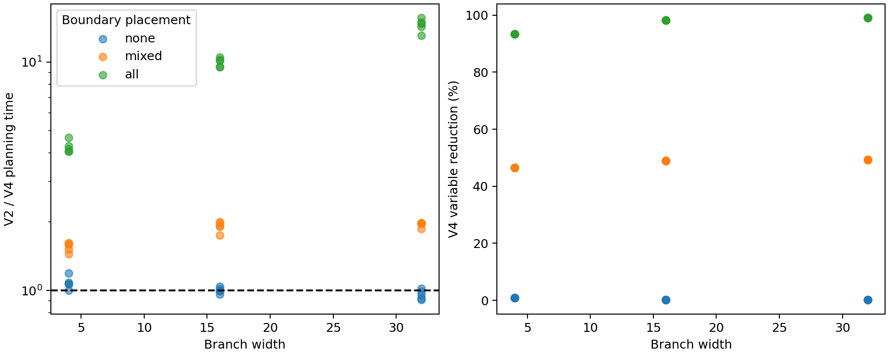
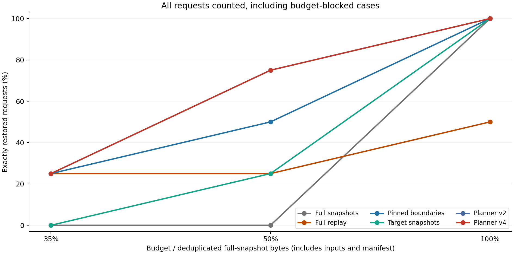

## Abstract

Historical machine learning pipelines contain source data and transformed features and fitted models and predictions whose complete snapshots can require unnecessary storage while replay alone can fail at external or nondeterministic operations.
RecoverML captures these artifacts in a content addressed dependency graph and chooses retained blobs under one byte budget and restores protected historical outputs by loading or replaying declared operators and verifies every result with SHA 256.
This paper studies an exact replayability frontier presolve for a load first recovery planner.
The reduction stops backward optimization at non replayable outputs and removes physical and replay decisions that cannot affect a protected request.
Exhaustive small graph tests and matched mixed integer programs preserve feasibility and optimal objective values.
On 15 Iris histories the formulation at depth 128 falls from 1256 variables to 69 and planning is 3.38 times faster at the median while all 450 matched planner sets reach the same proven optimum.
A separate wide topology study reaches 1038 nodes and reduces the largest model from 7218 variables to 33 with a 10.47 times median V2 to V4 speedup and 45 exact restores.
The extended evaluation adds a real PyTorch CNN and a text Transformer and 24 native checkpoint round trips and V4 restores all 48 admitted requests in a 432-request matrix exactly.
Boundary placement controls yield median speedups of 1.00 and 1.91 and 10.13 times for no and mixed and full boundaries respectively.
The results support contract-aware presolve for this declared recovery model and characterize its boundary-dependent benefit.

## 1 Introduction

Machine learning development creates many related pipeline versions.
Saving every intermediate artifact simplifies recovery but wastes storage and replaying everything saves storage but can be slow or impossible when a step depends on an unavailable service or unrecorded randomness.
Existing lineage and materialization and notebook time travel systems establish the importance of reuse and checkpointing but a retained historical output needs only the portion of the captured graph that its execution can actually reach.

RecoverML represents every captured operation and output as a node and records dependencies and parameters and replayability and a content hash.
The planner chooses physical blobs under a byte budget and the restore engine loads retained values or replays supported operators.
The executor checks the reconstructed serialization against the captured hash and fails closed when no exact path exists.

The main contribution is an exact replayability frontier for a load first executor.
When backward traversal reaches a non replayable node the output must be retained and its parents cannot be visited solely through that path.
Removing that hidden ancestry from the optimization model preserves the feasible protected recoveries and their objective values.

This paper makes four contributions:

1. A storage budgeted recovery model with explicit replayability contracts and exact hash checked restoration
2. A linear time frontier construction and exact formulation reduction with stated assumptions
3. An implementation with automated raw traces and checksums and correctness tests
4. Evaluation on public tabular data and a CPU neural network and executable graphs up to 1038 nodes

## 2 System and implementation

The captured pipeline is a finite DAG.
Each node records an operator and dependencies and parameters and replayability and one content addressed output.
Source blobs are mandatory and optional blobs compete for one storage budget.
A protected request names historical target nodes.
The runtime first loads a node when its blob exists and otherwise replays the operator when replay is declared and every dependency can be produced.
It rejects a missing non replayable output and rejects any rebuilt value whose serialization hash differs from the captured identity.

The guarantees require complete dependencies and accurate replay declarations and an acyclic graph and a matching execution environment.
The current system is an offline planner and does not provide transactional online admission or crash safe replacement of an active store.

The Python prototype captures block level inputs and preprocessing and fitted state and models and predictions.
It deduplicates equal serialized blobs by SHA 256 and records a manifest and source and environment identities.
The planner uses SciPy mixed integer optimization and post checks its incumbent against the byte budget and structural coverage and independently recomputed objective.
The disk restorer has no access to the original capture archive.

Supported estimators include logistic regression and random forests and a deterministic scikit learn multilayer perceptron and the PyTorch architectures described below.
Opaque external enrichment and entropy backed random augmentation are captured as non replayable outputs.

The evaluation separates capture and planning and restoration measurements.
It rotates planner timing order and retains raw trials and request traces and environment details and hashes.
Planner V2 uses the full captured model and V3 applies the replayability frontier and V4 also removes fixed variables.
Other baselines include full snapshots and mandatory input replay and direct target snapshots and a cost ranked cache.

The evaluation contains the earlier storage and concurrency matrices and a repeated Digits and Wine study and an Iris frontier depth study and the new Digits neural study and wide topology study.
All reported exact restores recreate captured hashes.

## 3 Precise optimization model

Let $G=(V,E)$ be a finite directed acyclic graph and let $B$ be its set of distinct physical blobs.
The map $b:V\rightarrow B$ associates a node with its captured output identity and several logical nodes may refer to the same blob.
Each blob has a serialized size $s_b$ and each operator has a replayability flag $p_v\in\{0,1\}$ and measured capture compute cost $c_v\geq0$.
The mandatory blob set is $M$ and the manifest occupies $m$ bytes.
A protected request $q$ names a target set $T_q$ and requests have separate in-memory memoization.

The planner chooses a physical storage variable $x_b$ for each blob and load and replay indicators $\ell_{qv}$ and $r_{qv}$ for each modeled request and node.
The storage constraint is:

$$m+\sum_{b\in B}s_bx_b\leq K,\qquad x_b=1\quad(b\in M)$$

The load cost is $d_v=20\,\mu s+s_{b(v)}/(500\times10^6)$ seconds and the objective is:

$$\min\sum_q\sum_v(d_v\ell_{qv}+c_vr_{qv})$$

The implementation applies the following binary constraints:

$$\ell_{qv}+r_{qv}\leq1,\quad \ell_{qv}\leq x_{b(v)},\quad r_{qv}\leq p_v,\quad r_{qv}+x_{b(v)}\leq1$$

For a target $v\in T_q$ the first sum must equal one.
For every dependency edge $u\rightarrow v$ the replay branch requires.

$$r_{qv}\leq\ell_{qu}+r_{qu}$$

The last load/replay constraint expresses the runtime rule that an available blob is loaded rather than recomputed.
It is needed because retaining an expensive-to-read artifact can otherwise disagree with a solver that prefers cheap replay.
The solver objective is an additive estimate and not a guarantee of future wall-clock latency.
File caching and hash verification and Python overhead and library startup remain outside this simple load-cost formula.

## 4 Exact physical presolve and its proof

For each request start from every target and follow dependencies backward.
Visit a node but do not follow its parents when $p_v=0$.
Let $F$ be the union of the resulting node sets and keep all mandatory blobs and every physical blob with at least one occurrence in $F$.
In particular a blob must not be removed merely because one of its logical occurrences is outside the frontier.

**Proposition 1.** Under complete recorded dependencies and accurate replay declarations the removal of an optional physical blob whose every occurrence is outside $F$ preserves the feasible protected recoveries and their modeled objective after projection.

*Proof.* A target is produced by loading a retained blob or replaying an eligible operator after its parents are produced.
A load does not visit that node's parents and an ineligible operator cannot use the replay branch.
Induction from the target nodes therefore places every visited node inside $F$.
A blob occurring only outside $F$ cannot be read by any feasible protected request so dropping it changes neither the executed path nor its modeled cost and releases rather than consumes storage.
Conversely any retained set over the reduced physical set is also a retained set in the original problem by setting removed decisions to zero.
The feasible projections and objective values are equal and therefore the minimum objective is equal.

**Proposition 2.** Fixing mandatory storage variables to one and non-replayable or mandatory-loaded replay variables to zero preserves the reduced problem.

*Proof.* Mandatory storage is an explicit constraint and a non-replayable node cannot execute.
A node with a mandatory blob is always loaded by the runtime and cannot use the replay branch.
Substitution eliminates decisions already fixed by these constraints without changing any admissible execution.

The frontier can be constructed in $O(|V|+|E|)$ time for one target union and uses $O(|V|)$ memory.
The implementation also maintains request-specific live sets so formulation construction retains a factor for the number of historical requests.
The remaining mixed integer optimization remains combinatorial and the reduction does not make the general storage problem polynomial.
RecoverML retains the complete provenance manifest and prunes solver decisions rather than deleting ancestry records.

### Shared-path example

Consider source data followed by cleaning and an external enrichment and model training and predictions.
If enrichment cannot be replayed then recovering predictions must either load the predictions directly or retain enough downstream artifacts to avoid the missing enrichment.
If the selected path reaches enrichment it must load its output and never needs cleaning solely through that path.
However a second protected request may explicitly ask for the cleaned data and then cleaning and its source remain live.
The frontier is a union across requests so this shared-path dependency is preserved.
The physical-blob rule also preserves a cleaned-data blob that happens to equal a live output even when its other logical occurrence is hidden.

### Scope of the guarantee

The proof applies to the declared graph and serialized identities and does not establish semantic completeness of arbitrary user code.
A hidden file read or undeclared side effect can invalidate the dependency contract.
Environment checks reject different recorded code and library and thread settings and exact output hashes catch divergent reconstruction.
These checks cannot prove that every dependency or source was recorded.
Stores are trusted local research artifacts and pickle decoding is not an interface for accepting untrusted files.

## 5 Relationship to prior work

HELIX includes backward output slicing in Section 5.4 and its load/compute/prune formulation already observes that materialized outputs can make ancestry unnecessary [1,2].
RecoverML therefore does not claim the invention of backward slicing or stopping computation at loaded artifacts.
The comparison concerns offline physical retention across multiple protected historical requests and the explicit projection theorem for that formulation.

ExoFlow explains committed task frontiers and nondeterministic output handling and gives a checkpoint vertex-cut invariant for exactly-once recovery [3].
Thus task contracts and mixed checkpoint/replay methods and the word frontier are established concepts.
RecoverML addresses immutable historical output retention under a byte budget rather than distributed rollback or externally visible transactions.

Kishu provides exact bytestring restoration for serializable notebook co-variables and fallback recomputation with a stated nondeterministic limitation [4].
Exact serialization restoration is also prior work.
RecoverML's explicit operator graph is narrower than Kishu's notebook integration and the paper does not claim broader library coverage.
LIMA establishes fine-grained lineage and reuse inside ML systems [5].
Checkmate formulates tensor rematerialization as a memory-constrained MILP and simplifies constraints [6].
The presence of a solver and a budget and a smaller formulation is consequently insufficient on its own to establish novelty.

The defensible contribution is the checked physical formulation and contract-aware presolve and an empirical account of when it helps.
The current audit has not located an identical combination of protected historical targets and physical alias preservation and load-first objective projection in these selected papers.
This observation is provisional and an independent novelty challenge is still required.

## 6 PyTorch workload and native-checkpoint validation

The extended evaluation uses PyTorch 2.9.1+cpu and one CPU thread.
The vision task is ten-class Digits classification on 1,797 real 8 by 8 images and a stratified 75/25 split.
Its model has two 3 by 3 convolutions with 16 and 32 output channels and a max-pooling layer and a linear classifier with 9,930 parameters.
Training uses Adam for eight epochs with a batch size of 64.

The language task uses four categories from the real 20 Newsgroups collection.
Headers and footers and quoted text are removed and each seed selects a balanced 800-document subset.
The stratified split precedes vocabulary fitting and the vocabulary is learned from training documents only.
The classifier uses a 2,048-entry embedding and 32-dimensional hidden states and two Transformer encoder layers with four attention heads and a 64-dimensional feed-forward sublayer.
Sequences are truncated to 32 tokens and padding masks are explicit.
This 83,780-parameter classifier is trained from scratch for six epochs and is not a pretrained language model.
Data source indexes and vocabulary and preprocessing rules and dataset content hashes are exported alongside checkpoint evidence.

Each architecture is evaluated with deterministic prepared inputs and separately with entropy-backed feature or token dropout that is recorded as non-replayable.
Three seeds and two historical versions yield 12 histories and 24 trained models.
Six policies at 35 and 50 and 100 percent budgets yield 432 requested restores.
The compared policies are full snapshots and mandatory-input replay and cost-ranked boundary pins and target snapshots and full-formulation V2 and compact V4.

Training weights are converted to a sorted numerical state dictionary for canonical artifact identity.
They are additionally exported to native .pt state dictionaries and loaded using PyTorch weights_only mode in a separate process.
This checks interoperability and exact inference after loading rather than treating PyTorch's container bytes as a canonical identity.
Optimizer state and training-resume semantics are outside this checkpoint scope.

An initial diagnostic run revealed that all-padding text could create nonfinite inference values even though hash equality still passed.
The final operator enables one attention key for an empty sequence and rejects nonfinite loss and weights and predictions.
The diagnostic measurements are preserved and explicitly excluded from final neural quality claims.
The corrected run uses a fresh output directory and is audited independently.

## 7 Controls and independent oracle method

The topology control experiment crosses three boundary placements with widths 4 and 16 and 32 at depth 16.
There are five seed blocks and nine rotated timing trials for each planner and case.
The no-boundary graph contains only replayable ancestry and the mixed graph places non-replayable outputs on half its branches while the full-frontier graph places a boundary after the shared merge.
All cases protect three output versions and execute the selected V4 plan against the captured hashes.
This matrix contains 45 histories and 1,215 planner executions and 135 exact restorations.

These controlled graphs deliberately assign zero replay cost to deterministic numerical operations so the direct-target shortcut is disabled and the global formulation is exercised.
Their values are small arrays and their timings characterize solver construction and planning rather than neural training throughput.
The no-boundary case is a negative control for the frontier reduction and is included whether the reduced planner wins or loses.

The independent oracle generates 128 small logical DAGs with physical aliases and overlapping targets and duplicate targets and varied replay eligibility and costs.
Its own recursion computes execution cost without calling the optimizer or Graph.coverage or Graph.estimate.
For every physical retained subset it checks that projection onto the frontier preserves feasibility and cost and it then checks every planner against the exhaustive optimum at tight and feasible budgets.
The study enumerates 2,048 physical subsets and performs 1,890 solver comparisons and all comparisons agree.
The generated graphs intentionally reuse four optional physical values so the subset count is manageable and the logical graph variety is broader than the physical search space.
This is independent code within the same research project and not an independent external reproduction.

Timing summaries first reduce repeated trials to one median per history.
The same seed is used at several widths so confidence intervals resample whole seed blocks and keep their width observations together.
Repeated timing trials are not counted as separate statistical subjects.
Intervals describe within-machine variation and do not imply a population of different machines.

## 8 Results

The earlier Iris study contains 15 histories and 1,350 planner executions and 120 exact restores.
All 450 matched planner sets reach proven optima and equal objectives and the depth-128 formulation decreases from 1,256 to 69 variables.
Its median V2/V4 planning speedup is 3.38 times and the separate wide study reaches 1,038 nodes and reduces its largest model from 7,218 variables to 33 with 10.47 times median speedup and 45 exact restores.
These results use separate captured histories and are not pooled with the new controls.

The new controls preserve every optimum and exact output and their benefit follows boundary placement.
Table 1 reports the median of the history-level speedups and 95 percent seed-block bootstrap intervals.

| Boundary placement | Histories | Median V2/V4 speedup | Seed-block 95% interval | Median variable reduction |
|---|---:|---:|---:|---:|
| No boundary | 15 | 1.00 | 0.99-1.02 | 0.22% |
| Half the branches | 15 | 1.91 | 1.74-1.97 | 48.91% |
| After the shared merge | 15 | 10.13 | 9.52-10.52 | 98.21% |



Across the final PyTorch matrix V4 restores 48 of 48 admitted requests and blocks 24 infeasible requests before execution.
Every request remains in the denominator when storage coverage is compared:
Table 2 reports exact requests at the 50 percent budget across the 12 histories.

| Policy | Exact / requested at 50% budget |
|---|---:|
| Full snapshots | 0 / 24 |
| Full replay | 6 / 24 |
| Pinned cost | 12 / 24 |
| Direct target snapshots | 6 / 24 |
| Full planner V2 | 18 / 24 |
| Compact planner V4 | 18 / 24 |



At the full budget target snapshots and both planners restore all 24 requests and the direct-target baseline remains a strong reference.
The 36 full-replay failures across budgets are expected missing non-replayable outputs and the audit finds no unexpected failures.
V2 and V4 have identical coverage so the presolve changes formulation work rather than adding a new recovery path.
The native-checkpoint audit separately round-trips all 24 state dictionaries and reproduces every captured prediction hash.
All final checkpoint weights and probabilities are finite.

The CNN has median test accuracy of 95.56 percent with a range of 94.22-97.33 percent and the Transformer has median test accuracy of 45.25 percent with a range of 42.00-49.50 percent over deterministic and augmented versions together.
The four-class balanced text task has a 25 percent chance reference so the trained Transformer learns a task signal but is not a competitive language benchmark result.
Accuracy verifies the workloads are fitted classifiers and is not an improvement claimed for RecoverML.

## 9 Interpretation and threats to validity

The current evidence supports three conclusions.
The checked reduction preserves the tested modeled objectives and exact recoveries.
The planning benefit grows when a large part of the captured ancestry becomes irrelevant through non-replayable boundaries.
The same restoration interface can handle trained scikit-learn and CPU PyTorch state and actual vision and language-classification data.

The negative control gives a median V2/V4 speedup near 1.00 and only about 0.22 percent fewer variables.
Mixed boundaries give about 1.91 times median speedup and 48.91 percent fewer variables while full boundaries give about 10.13 times speedup and 98.21 percent fewer variables.
This pattern supports the mechanism and limits claims of universal improvement.
The older wide study's 10.47 times result and the new control study's 10.13 times result are separate experiments and must not be merged as one number.

The neural pipelines contain only a handful of operator nodes even though training uses real learned parameters.
They test framework compatibility and storage coverage rather than thousand-node neural graphs.
The topology study provides the graph-size stress test but does not have large tensor payloads.
Future evaluation should combine these two axes with a larger practical workflow.
No current result establishes a GPU speedup or bitwise portability across CPU/GPU or across different PyTorch versions [7].

The proposed planners minimize a fixed load model and capture-time replay costs.
Optimality therefore refers to that estimate and measured restore latency can differ because of file caching and hash checks and runtime overhead.
At roomy budgets target snapshots are a particularly strong baseline and an optimizer may reasonably choose the same artifacts.
Comparisons with the local full formulation establish presolve overhead and objective preservation and do not establish performance superiority over original HELIX or Kishu or ExoFlow implementations.

All reported timings are from one CPU execution environment.
The GitHub workflow now includes an additional PyTorch test and boundary-control job but its results cannot be counted as a second-machine replication until it has actually run and its artifacts have been audited.
A human novelty review and target-venue choice and venue-specific manuscript formatting remain outstanding.

## 10 Conclusion

RecoverML provides a checked storage-planning formulation for multiple historical outputs and a physical-blob-aware presolve under explicit replay contracts.
The formulation preserves protected recoverability and modeled optima in the exhaustive and paired experiments.
The control study locates its practical benefit in ancestry hidden by non-replayable boundaries and records a no-benefit control alongside larger gains.
CPU PyTorch vision and text workloads and native checkpoint round trips extend the implementation evidence beyond the original scikit-learn prototype.
The remaining steps toward submission are independent machine reproduction and a novelty challenge and venue-specific editing.

## Appendix: artifact and reproduction

The repository contains source and configs and tests and raw CSV and JSONL logs and numerical reference identities and plots and checksums.
Generated full capture archives are excluded from the compact public package and can be regenerated using the recorded configs.
The final native checkpoints and dataset provenance are included as evidence.
Each experiment refuses to overwrite an existing output directory.

Install the core package and the CPU framework and obtain the text data once.

```bash
python -m pip install -e .
python -m pip install torch==2.9.1 --index-url https://download.pytorch.org/whl/cpu
python - <<'PY'
from sklearn.datasets import fetch_20newsgroups
fetch_20newsgroups(subset='all',
                  remove=('headers','footers','quotes'))
PY
make test
make pytorch-study
make boundary-controls
make oracle-audit
```

The analysis generator produces the final coverage and checkpoint-quality and cluster-statistics tables directly from raw files.
Its input hashes and source hashes identify the exact inputs to manuscript claims.
The tests additionally cover artifact corruption and missing opaque outputs and incorrect environment declarations and solver limits and incorrect solver objectives and trace completeness.

## References

[1] Xin et al. HELIX: Holistic Optimization for Accelerating Iterative Machine Learning. Proceedings of the VLDB Endowment, 12(4), 446-460. [Primary paper](https://www.vldb.org/pvldb/vol12/p446-xin.pdf).

[2] Doris Xin, Litian Ma, Jialin Liu, Stephen Macke, Shuchen Song and Aditya Parameswaran. HELIX: Accelerating Human-in-the-loop Machine Learning. PVLDB 11(12), 1958-1961, 2018. [DOI](https://doi.org/10.14778/3229863.3236234).

[3] Siyuan Zhuang, Stephanie Wang, Eric Liang, Yi Cheng and Ion Stoica. ExoFlow: A Universal Workflow System for Exactly-Once DAGs. OSDI, 269-286, 2023. [Primary paper](https://www.usenix.org/conference/osdi23/presentation/zhuang).

[4] Li et al. Kishu: Time-Traveling for Computational Notebooks. Proceedings of the VLDB Endowment, volume 18, 2025. [Primary paper](https://www.vldb.org/pvldb/vol18/p970-li.pdf).

[5] Arnab Phani, Benjamin Rath and Matthias Boehm. LIMA: Fine-grained Lineage Tracing and Reuse in Machine Learning Systems. SIGMOD, 2021. [DOI](https://doi.org/10.1145/3448016.3452788).

[6] Paras Jain et al. Checkmate: Breaking the Memory Wall with Optimal Tensor Rematerialization. MLSys, 2020. [Primary paper](https://proceedings.mlsys.org/paper_files/paper/2020/file/0b816ae8f06f8dd3543dc3d9ef196cab-Paper.pdf).

[7] PyTorch contributors. [Reproducibility](https://docs.pytorch.org/docs/stable/notes/randomness.html) and [serialization semantics](https://docs.pytorch.org/docs/stable/notes/serialization.html). Official documentation.

[8] scikit-learn contributors. [Digits](https://scikit-learn.org/stable/modules/generated/sklearn.datasets.load_digits.html) and [20 Newsgroups](https://scikit-learn.org/stable/modules/generated/sklearn.datasets.fetch_20newsgroups.html) dataset documentation.

