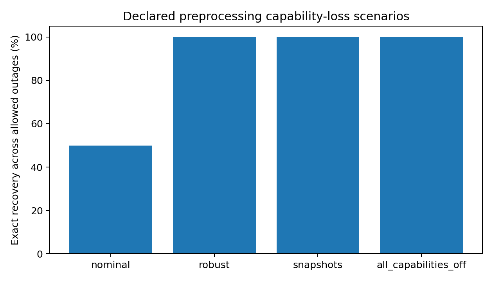
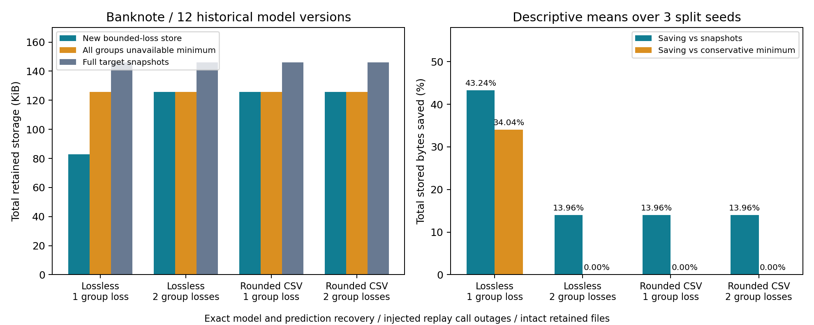

# Capability loss recovery evidence

Read [the method and three contributions](../../../docs/CAPABILITY_LOSS_NOVELTY.md) first

| Folder | Contents |
|---|---|
| pilot | Three version pilot including zero snapshot savings |
| standard | Twelve version Breast Cancer and Iris and Wine study |
| banknote | Independent new public dataset with the single local scaler backend |
| dual_pilot | First one seed four policy check with two scaler backends |
| dual_scaler | Complete three seed four policy scaler backend study |
| scaling | Generated analytic controls for larger failure universes |
| disk_audit_verified | Independent replay of all 3168 dual study outcomes from the archived stores |
| source_snapshot | Exact earlier intermediate source files checked against provenance hashes |

Every group includes its raw request log as execution_traces.json.gz and its original reports and summaries
Planner certificates are compressed without changing their JSON content
The evidence inventory records the saved file hashes and uncompressed content hashes
The complete selected disk stores are in stores.tar.gz and identical payloads use internal tar hard links so each original path remains available

To inspect a raw request log

```bash
gzip -dc dual_scaler/execution_traces.json.gz | python -m json.tool
```

To extract the selected stores into a new review folder

```bash
mkdir -p /tmp/recoverml_capability_review
tar -xzf dual_scaler/stores.tar.gz -C /tmp/recoverml_capability_review
```

Use the matching capture environment for replay and keep the implementation hash checks enabled
The local source checkpoints are f625a6f for the initial solver and d19595c for the dual backend study and exact initial source copies are included in source_snapshot
The current suite log is tests_63.txt and reports 58 passing tests and five optional PyTorch tests skipped
The scaling universe is symbolically certified and selected probes are executed and the large scenario count is not a count of executed requests

To repeat the independent disk only audit from the repository root

```bash
PYTHONPATH=src python scripts/capability_disk_audit.py \
  --evidence results/research/capability_loss_oct13/dual_scaler \
  --output results/runs/new_capability_disk_audit
```




