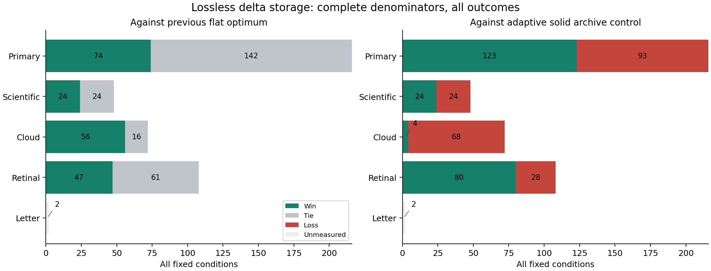

# Lossless delta storage: complete results, 27 October 2026

The implementation reduces complete persistent storage in **201 of 444
measurable conditions**, ties in **243**, and increases none because the old
flat format remains an explicit fallback. The largest new reduction is
**39.53%**, from **2,244,687 to 1,357,471 bytes**, for the scientific Digits forest
history under broad capability loss. Both Letter conditions remain in the full
**446-condition denominator**, with their original availability limitations.

**The broad superiority goal was not met.** Only 11/446 conditions reach a 10%
storage saving over the previous flat optimum. The primary gate passes in
**0/72 strata**. The equal-format exact oracle ties all 444 measured optima.
An adaptive solid archive is smaller in 213 comparisons. These outcomes are
retained, rather than restricting the report to successful histories.

## What changed

Each eligible artifact may use a full encoded file or an exact prefix/suffix
delta from an earlier canonical artifact. The planner charges every required
base and the complete 89-byte delta header. Its optimization graph distinguishes
storage decoding from ML replay: replay cannot supply a missing retained base.
Every reconstructed artifact keeps its original SHA-256 identity. A bounded
decoder rejects corrupt or missing bases, invalid lengths and cycles. Export
of retained targets requires no ML imports; model replay retains the original
environment guard.

These are established lossless coding and optimization techniques integrated
into the checked storage/recovery system. No new general compression algorithm
or optimization theorem is claimed. The certified minimum is relative to the
declared full-file/single-base candidate inventory, not every possible encoding.

## Complete storage comparison

The production choice is the smaller complete store from the old flat optimum
and the new delta optimum. All metadata, roots and retained bases are included.

| Population | Conditions | Smaller | Equal | Larger | Unmeasured | At least 10% smaller | Largest saving |
|---|---:|---:|---:|---:|---:|---:|---:|
| Primary catalogue | 216 | 74 | 142 | 0 | 0 | 7 | 28.83% |
| Scientific transfer | 48 | 24 | 24 | 0 | 0 | 4 | 39.53% |
| Three-seed cloud transfer | 72 | 56 | 16 | 0 | 0 | 0 | 2.16% |
| Retinal transfer | 108 | 47 | 61 | 0 | 0 | 0 | 0.19% |
| Letter transfer | 2 | 0 | 0 | 0 | 2 | 0 | unavailable |
| **All conditions** | **446** | **201** | **243** | **0** | **2** | **11** | **39.53%** |

The median saving over measurable conditions is **0%**. These are correlated
conditions built from reused captures, not independent production samples.
The scientific histories informed the exploratory pilots and are not held-out
validation. No production win probability is inferred.



## Stronger comparisons and limitations

| Comparator | Wins | Ties | Losses | Unmeasured | Interpretation |
|---|---:|---:|---:|---:|---|
| Previous flat optimum | 201 | 243 | 0 | 2 | A different storage representation lowers some previous byte costs. |
| Stronger local-search control | 22 | 422 | 0 | 2 | Keeps the best previous flat plan, its delta conversion, and the newly measured delta-graph plan. |
| Same-format exact reference | 0 | 444 | 0 | 2 | Two independently coded exact formulations agree on the new objective. |
| Adaptive solid archive of the flat optimum | 231 | 0 | 213 | 2 | Standard joint compression remains a substantial competing storage option. |

The stronger local comparison is a disclosed **post-hoc control**. Expanding
the representation graph sometimes makes the heuristic worse, so comparing
only its new run would overstate the advantage. Preserving its previous best
plan removes 14 apparent wins: the fresh graph-local count is 36 wins/408 ties,
while the stronger count is 22 wins/422 ties. The complete converted-store
inventories, original selections and decode checks are in
[strengthened_local.json.gz](strengthened_local.json.gz).

The maximum stronger-local gap is **74.02%** (35,469 versus 136,505 bytes), on
`shared/wine-s20261016-v64-concat0`. **RecoverML uses its previous flat optimum
in this case**; this gap is not evidence that today's delta format produced a
74% improvement. Nine conditions reach a 10% stronger-local gap. The median
gap is zero.

Joint compression also exposes a large remaining weakness: for
`digits/pca_neighbors/v16/broad`, the selected delta store is **1,449,485 bytes**
versus **148,050 bytes** for the solid archive control. Conversely, the
scientific forest case with seed 211 is **1,346,283 versus 1,848,636 bytes**,
a **27.17%** saving over that archive. These results do not establish overall
archive dominance or faster random access. The archive control uses the old
flat-optimum selection; an optimum over every possible archive selection is
not claimed.

Changing retention selection after enabling deltas improves only **1/444**
measured conditions over converting the previous exact retained set, by
**11.14%** in that condition. Most of the new savings come from encoding,
not a different selection. Planning, compression, recovery latency and peak
memory were not benchmarked here; no new speedup is asserted.

An oracle attaining the minimum under identical rules cannot be strictly
beaten on that same byte objective. A smaller result would require different
rules or an error in the claimed optimum. Improving the format can lower the
minimum, but the reference supplied with that same format can match it.

## Verification and provenance

- All **28 final data jobs** and their separate audits passed in
  [run 40467717174](https://github.com/Hannaancode/RecoverML/actions/runs/40467717174),
  using source commit
  [f16aa47](https://github.com/Hannaancode/RecoverML/commit/f16aa4709937d30144421024d11b442f03835479).
  The acceptance job also passed. Both exact formulations agree in all 444
  complete cases; no solver timeouts are hidden.
- **22,869 selected-file decode/hash checks** cover the four measured delta
  methods across the full grid. These include repeated files across methods
  and conditions; they are not 22,869 distinct models or new end-to-end replay
  requests. Every allowed original capability-loss certificate is checked.
- Unit/integration checks cover exhaustive paid-file subsets, cyclic alternate
  ML producers, normalization preserving the entire decoded closure, exact
  byte accounting, missing/corrupt bases, no-ML-import export, and strict replay
  across all four census recipe families. All three CI jobs passed on the
  corrected implementation in
  [run 40467717037](https://github.com/Hannaancode/RecoverML/actions/runs/40467717037).
- The [first attempt](https://github.com/Hannaancode/RecoverML/actions/runs/40466699997)
  rejected duplicate full/delta choices in two heuristic PCA blocks. The
  correction preserves every decoded value while removing redundant copies;
  it strengthens the baseline. All conditions were rerun. All **56 original
  data artifact ZIPs** from both attempts are preserved as **78 transport
  parts**, totaling **66,377,675 bytes**, with GitHub digests and member hashes
  in [artifact_manifest.json](artifact_manifest.json).
- The initial neural CI failure was caused by a shallow checkout missing the
  pinned input-release commit; the checkout was corrected. No runtime or
  integrity check was bypassed. Acceptance ZIPs and local validation logs are
  retained under [validation](../../validation/2026-10-27/delta_storage).
- Rejected and successful exploratory approaches are retained in
  [exploratory](exploratory/README.md), with explicit limits on their provenance.

One Letter condition has only its old selected payloads, and the other lacks
required selected payloads. Neither supports a new delta optimum. The missing
original Letter archive container remains missing; this work does not close
that provenance gap. Genuine course peer review and manuscript integration
are not produced by these automated checks.

## Reproduce and inspect

Use the pinned Python environment in the repository reproduction guide and a
fresh output path. A full saved-data audit reconstructs the original artifacts,
checks every final condition against its original bytes, solves the independent
reference again, and rebuilds the stronger local control:

```bash
PYTHONPATH=src OPENBLAS_NUM_THREADS=1 OMP_NUM_THREADS=1 \
  python scripts/audit_delta_storage_release.py results/research/delta_storage_oct27 \
  --output work/new_delta_release_audit.json --workers 2
```

The result is a byte-level evidence audit, not a fresh model-replay or timing
experiment. [All conditions](all_conditions.csv), [machine-readable totals](summary.json),
the [protocol](../../../docs/DELTA_STORAGE_OCT27.md) and the [fixed grid](../../../configs/delta_storage_oct27.json)
preserve the full denominator and the failed primary success gate.
