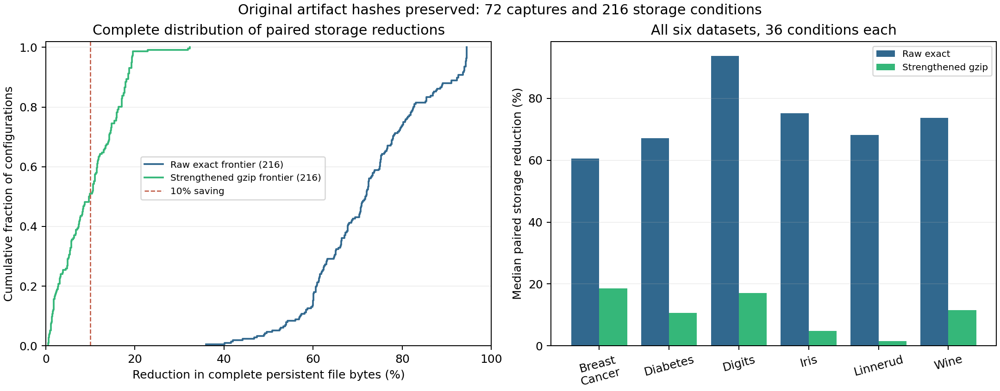
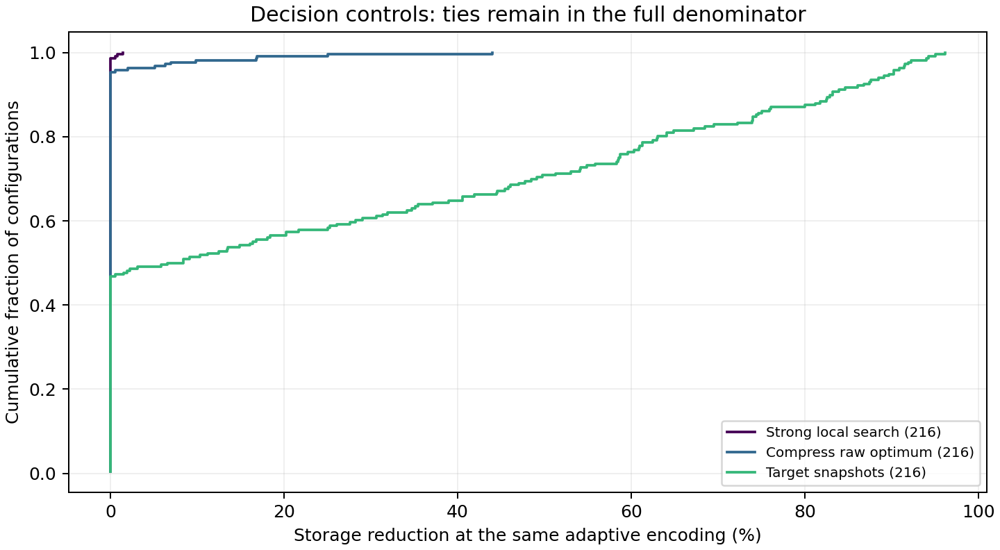

# Lossless storage and deterministic time travel, 26 October 2026

The optional encoded store preserves **the original canonical artifact bytes and SHA-256 identities**.
Across the complete 72-capture catalogue, it uses less persistent storage than the raw exact frontier in **216/216 conditions**:
**71.83% median reduction**, with a **35.96% minimum** and **94.49% maximum**.
Every dataset, recipe and loss stratum passes the prespecified 10%-saving / 90%-of-conditions engineering gate.
This is an encoding-aware systems improvement using established compressors, not a new general optimization algorithm.

The stronger compressed comparison matters: savings over a gzip frontier that also permits byte shuffling and raw fallback are
**9.80% at the median**, **0.55%-32.32%** across all 216 conditions.
All 216 are smaller, but only **106/216** exceed 10% savings against that stronger control.
A substantial 10% gain in at least 90% of cases against strong compression is therefore **not established**.
Giving all methods the same adaptive codec preserves many ties, including every supplied manual optimum.

## Complete fresh experiment

The [fixed protocol](../../../docs/ENCODED_STORAGE_OCT26.md) uses all six datasets, four recipe families,
history lengths 1/4/16 and intact, preprocessing-loss and broad fitting/prediction-loss contracts.
Each request asks for every protected historical model and prediction under one permitted loss set.
There are **216 storage conditions and 4,536 actual requests**, rather than 216 independent datasets.
All **3,024/3,024 requests of the six robust controls** recover exactly.
The full total is **4,320 exact requests, 216 expected adapter blocks and zero unexpected outcomes**.
There are **51,998 verified output-file hashes**, including valid partial outputs from blocked requests.
Adaptive exact itself completes **504/504 requests** and all **216/216 preservation conditions**.

| Dataset | Conditions with at least 10% raw saving | Median raw saving | Median strengthened-gzip saving |
|---|---:|---:|---:|
| Breast Cancer | 36/36 | 60.62% | 18.50% |
| Diabetes | 36/36 | 67.13% | 10.66% |
| Digits | 36/36 | 93.75% | 17.04% |
| Iris | 36/36 | 75.12% | 4.88% |
| Linnerud | 36/36 | 68.21% | 1.46% |
| Wine | 36/36 | 73.73% | 11.55% |

| Other fixed stratum | Conditions | Median raw saving | Median strengthened-gzip saving |
|---|---:|---:|---:|
| Min-max plus tree | 54 | 72.04% | 10.69% |
| PCA plus neighbors | 54 | 61.10% | 6.04% |
| Robust scaling plus forest | 54 | 78.03% | 11.79% |
| Standardized linear model | 54 | 70.68% | 10.65% |
| Intact capabilities | 72 | 75.18% | 11.47% |
| Preprocessing loss | 72 | 70.38% | 9.32% |
| Broad fitting/prediction loss | 72 | 70.68% | 7.16% |

No fixed workload is removed or reweighted after execution. These are authored histories on small built-in datasets;
their win rate does not estimate production prevalence. Related versions and losses are not independent population samples.



## Same-codec policy controls

All adaptive policies receive identical encoding options, mandatory roots, protected targets and loss contracts.
Independent scenario optimization agrees with every raw/gzip/adaptive exact minimum.
The manual control is supplied that optimum and ties **216/216** adaptive byte minima.

| Control | Full preservation conditions | Actual exact requests | Storage comparison with adaptive exact |
|---|---:|---:|---|
| Raw exact | 216/216 | 504/504 | 216 smaller adaptive stores; representation differs |
| Original gzip exact execution control | 216/216 | 504/504 | 216 smaller adaptive stores; codec options differ |
| Adaptive exact | 216/216 | 504/504 | Checked minimum for declared encoded costs |
| Strong local search, adaptive codec | 216/216 | 504/504 | 3 smaller exact stores, 213 ties; maximum reduction 1.45% |
| Target snapshots, adaptive codec | 216/216 | 504/504 | 115 smaller exact stores, 101 ties |
| Compress raw optimum without reselecting | 216/216 | 504/504 | 10 smaller reselected stores, 206 ties; maximum reduction 43.99% |
| HYPPO rank component, same budget | 169/216 | 453/504 | Partial preservation at the exact optional-byte budget |
| HYPPO frequency component, same budget | 151/216 | 415/504 | Partial preservation at that budget |
| HELIX rule adapter, same budget | 161/216 | 428/504 | Partial preservation at that budget |

Every broad-loss condition ties same-codec snapshots and local search.
Compression reduces encoded file length even when the contract permits no target-file eviction;
it does not turn a same-codec retention tie into an optimization win.
The extra reselection gain occurs in 10 preprocessing-loss conditions; its full-grid median is zero.
The published components/rule are common-executor adapters, not complete native HYPPO or HELIX systems.
No weights are fitted to make every comparator a win.



## Post-hoc strengthening of gzip

The original frozen gzip policy chooses shuffled or unshuffled gzip level 9.
The audit found **34 of 1,154 captured candidate-file occurrences** would be smaller with raw fallback.
The additional control permits raw files too, reoptimizes with two exact formulations, materializes each selected store,
and verifies every selected file against its original hash. It uses original saved gzip bytes and deterministically reconstructible raw bytes.

This is a disclosed **post-hoc baseline strengthening**, not a replacement experiment or an additional model-replay count.
It changes no original workload, request, threshold or timing. Proofs and inventories are in `strengthened_gzip.json.gz`.
Original gzip execution results remain preserved; headline gzip savings above use the stronger control.

## Every older frozen condition

The [transfer protocol](../../../docs/ENCODED_TRANSFER_OCT26.md) checks original bytes and preservation certificates.
These are **byte-level round trips and new encoded-cost objectives, not fresh model replays**.
All 230 older conditions remain visible, including two incomplete Letter objectives.

| Frozen group | Full objectives | Selected-store only | Unavailable selected store | Median raw saving on full objectives | Median strengthened-gzip saving |
|---|---:|---:|---:|---:|---:|
| Scientific | 48 | 0 | 0 | 85.37% | 14.02% |
| Three-seed separate/shared views | 72 | 0 | 0 | 60.75% | 8.16% |
| Retinal | 108 | 0 | 0 | 70.37% | 15.60% |
| Letter | 0 | 1 | 1 | Not established | Not established |

All 228 full objectives beat the raw and strengthened gzip controls.
The existing Letter preprocessing frontier can be reencoded from **4,829,269 to 282,560 bytes**;
the fixed-selection shuffled-gzip control uses 406,838 bytes.
Missing alternative candidate payloads prevent a new encoded optimum claim there.
The broad Letter selected payloads remain unavailable. Counting it as a nonwin, 229/230 older conditions have a measured store
with at least 10% raw-byte savings, while only 228 have a full encoded optimization comparison.
The original missing Letter archive container is not declared recovered.

## Format and guarantee boundary

The store uses established raw/zlib/XZ/gzip encodings and a fixed reversible eight-byte shuffle.
Metadata retains the original graph/environment and preservation contract. Every retained payload includes its mode byte.
Selection uses a cost-only graph with encoded lengths; recovery uses original canonical sizes/hashes.
Only selected encoded files are recovery inputs. There is no plaintext mirror or capture-oracle fallback.
All metadata, headers, roots and mode bytes count in the sum of regular persistent file lengths.
Filesystem directory/block allocation overhead is outside this metric, as in the earlier accounting.
Decoded requested outputs, replay RAM, decoder availability and compression CPU cost are separate requirements.
Compression CPU cost was not isolated in a controlled performance comparison and is not claimed to be free.

Retained-file export verifies original bytes without loading model libraries. Replay still enforces the supported environment and operators.
Exact artifact bytes do not promise arbitrary future model execution, original event replay or training-resumption state.
This study does not remeasure native DVC latency or establish an encoded-store speed advantage.

## Provenance and reproduction

Fresh source: **8cc20b57cb1566e6a7f0bedefa08cd7bb3e34509**;
[24-block run](https://github.com/Hannaancode/RecoverML/actions/runs/40351032954).
Transfer source: **8d868f92a75c910f3e33001e9715d5704a71680e**;
[four-group run](https://github.com/Hannaancode/RecoverML/actions/runs/40353106464).
Both runs and every original block audit passed. Excluded smoke/preflight artifacts remain under `results/validation/2026-10-26/encoded_storage`.

`artifact_manifest.json` binds all **28 original artifacts, 97,458,348 bytes**, 65 transport parts and every original member's hash/size.
Encoded payloads, canonical manifests, source snapshots, actual selected-store inventories, all request traces and runner audits are preserved.
The release checker reconstructs every artifact, independently rechecks objectives/requests, compares all 28 runner audits,
and recreates the stronger gzip controls. CSV tables, figures and summaries are derived views.

```sh
PYTHONPATH=src python scripts/audit_encoded_storage_release.py results/research/encoded_storage_oct26 --output work/new_encoded_audit.json
PYTHONPATH=src python scripts/summarize_encoded_storage.py --audit work/new_encoded_audit.json --evidence results/research/encoded_storage_oct26 --output work/new_encoded_figures
```

Use a fresh output path. The format's create/recover CLI and callback API are documented in the protocol.
The result is smaller verified stores within the stated encoding inventory, not superiority over every established system.
