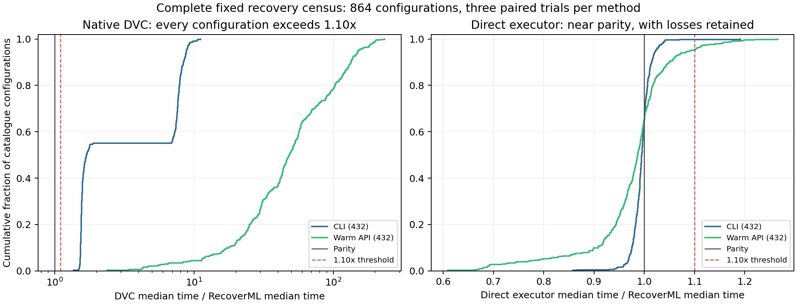

# Complete recovery census, 26 October 2026

RecoverML passes the fixed substantial-speedup gate against the tested native DVC integration in **864/864 configurations**.
Every configuration exceeds a **1.10x** median elapsed-time ratio, exceeding the required 90% in every reported stratum.
All **7,776/7,776 trials recover exactly**, with **54,540 requested-file SHA-256 checks** and zero failures.
Each of the three methods contributes 2,592 exact trials and 18,180 hash checks.
The result concerns this complete authored catalogue; it does not estimate a probability of winning on unknown production workloads.

## Primary recovery result

| Interface | Configurations at least 1.10x faster than DVC | Median paired DVC/RecoverML time | Smallest paired ratio |
|---|---:|---:|---:|
| CLI, including startup | 432/432 (100%) | **1.6952x** | 1.3658x |
| Warm API | 432/432 (100%) | **48.3212x** | 2.3796x |

Each ratio compares per-method medians from three paired, deterministically randomized-order repetitions.
The primary timing includes the call and final requested-output inventory/hash verification.
Warm imports are excluded for all methods; DVC's per-request Repo construction and replay subprocess are included.
Setup, capture, cache preparation and log writing are excluded. Operating-system caches are not flushed.
The speedup is for these end-to-end integrations, including DVC orchestration, rather than faster model training.

Across CLI configurations, marginal median elapsed times are 842.33 ms RecoverML and 1,348.63 ms DVC.
Across warm-API configurations they are 8.01 ms and 948.52 ms respectively.
Ratios of those marginal medians are not the median paired speedups in the table.
Some API requests export already retained files in under one millisecond, so relative gains can be large despite small absolute costs.
Persistently reused DVC Repo objects, other DVC storage/cache policies, remote storage and distributed recovery were not measured.

## Complete catalogue and subgroup results

Six public datasets, four recipe families and three history lengths produce **72 captures**.
Three loss contracts, two request sizes and two interfaces yield **864 configurations**.
Latest/all requests coincide at history length one; repeated conditions and related histories are not independent datasets.
Every fixed cell remains in the denominator. No favorable subset or fitted composite score defines success.

| Dataset | Substantial DVC wins | Median paired speedup, both interfaces |
|---|---:|---:|
| Breast Cancer | 144/144 | 9.1551x |
| Diabetes | 144/144 | 9.1565x |
| Digits | 144/144 | 8.3544x |
| Iris | 144/144 | 10.1635x |
| Linnerud | 144/144 | 8.9643x |
| Wine | 144/144 | 10.1896x |

| Other prespecified stratum | Substantial DVC wins | Median paired speedup |
|---|---:|---:|
| Min-max scaling plus tree | 216/216 | 9.1559x |
| PCA plus neighbors | 216/216 | 9.6747x |
| Robust scaling plus forest | 216/216 | 8.2428x |
| Standardized linear model | 216/216 | 9.6611x |
| Intact capabilities | 288/288 | 2.1443x |
| Preprocessing loss | 288/288 | 8.5113x |
| Broad fitting/prediction loss | 288/288 | 11.6089x |
| All historical targets | 432/432 | 8.8616x |
| Latest targets | 432/432 | 11.3609x |

Dataset, recipe, loss and request tables mix interfaces for stratified coverage; the interface table is the primary latency summary.
Every constituent cell passes, so the result also survives collapsing duplicate one-version latest/all cells or positively reweighting the measured cells.
This fact does not correct selection bias in the authored catalogue or justify a population confidence interval.
These are small built-in classification/regression datasets and four deterministic recipe families, not a production trace sample.

## Storage fairness and the direct-executor boundary

All methods receive the same certified optimal retained payloads, with selection cost free for DVC.
Independent exact optimization reproduces every selected byte minimum.
Output directories begin empty; only paid retained cache objects survive and hard links prevent duplicate paid-cache storage.
DVC uses native checkout when all requested files are retained and one exact-request batch repro otherwise.
There are **388 all-retained configurations** and **476 requiring replay**; each group passes completely.
The 432 distinct retention/request records comprise 194 all-retained and 238 with no requested target retained; none are mixed.
Consequently this catalogue does not establish performance for mixed retained/replayed requests.

A separately coded direct executor runs every configuration and supplies DVC's replay body.
It shares the selective retained-file export helper with RecoverML.
RecoverML is faster in **301/864** direct-control comparisons, reaches a 1.10x speedup in **21/864**,
and is at least 1.10x slower in **48/864**. The remaining 795 lie within those reciprocal thresholds.
The median direct/RecoverML ratio is **0.9929**, slightly favoring the direct control.
This is evidence of lower orchestration overhead than the tested native DVC path, not dominance over a minimal recovery executor.
Manual retention still matches the exact storage optimum; complete native HYPPO and HELIX systems were not evaluated here.



## Implementation and provenance

The production file API accepts explicit protected targets, exports retained files without model deserialization,
and uses the checked witness restorer when replay is required. Store discovery enumerates actual retained files.
Corrupt files and unsupported requests fail closed. Both baseline workers can use the same retained-target fast path.
This is a systems implementation using established optimization methods.

The [protocol](../../../docs/RECOVERY_CENSUS_OCT26.md) and machine-readable catalogue were committed before full execution.
Runtime source is **5174f3a669df73fa963a0003c6db2af49a9538be**.
The [original execution run](https://github.com/Hannaancode/RecoverML/actions/runs/40337905283) completed all 24 benchmark blocks.
Its initial block audits failed on lexical versus numeric version-key ordering; the one-version acceptance test did not expose that checker defect.
The repair has a 16-version regression test.
The [verification-only run](https://github.com/Hannaancode/RecoverML/actions/runs/40340457810), at repair commit
ed970c14e0dad6ecf21dd973a332ca1609ca7fee, passed the corrected complete audit over the original artifacts.
No timing was rerun and no workload, threshold or measured value changed after that audit failure.
The original failed statuses, excluded preflight attempts and smoke acceptance are retained under
`results/validation/2026-10-26/recovery_census`.

`artifact_manifest.json` identifies all 24 original ZIP artifacts (15,100,868 bytes), their GitHub digests,
transport parts and every member's size/hash. ZIPs retain source snapshots, capture payloads, selected stores,
native stages, all repetitions, command/API logs and worker receipts. The corrected cloud-audit ZIP and receipt are also preserved.
`audit.json` is the complete local reconstruction/check; `all_comparisons.csv` and `summary.json` are derived views, not replacement evidence.

```sh
PYTHONPATH=src python scripts/audit_recovery_census_release.py results/research/recovery_census_oct26 --output work/new_complete_census_audit.json
python scripts/summarize_recovery_census.py work/new_complete_census_audit.json --output work/new_census_figures
```

The complete checker verifies source snapshots against Git history, every payload hash, the full trial grid,
declared losses, exact storage minima, paid cache bytes, method ordering, receipts and all summary values.
It also requires equality with the preserved verification-only cloud audit.
Materialize the original blocks separately with `scripts/materialize_recovery_census.py DIRECTORY --output FRESH_DIRECTORY`.
Saved-data verification is not a fresh timing reproduction.
