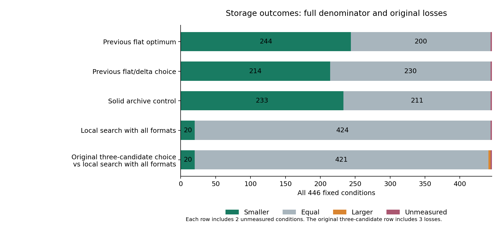

# Executable joint compression and complete storage comparisons

The five-candidate storage choice reduces persistent bytes in **244/444
measurable conditions** versus the previous flat optimum, ties in **200**, and
increases none. The maximum reduction is **89.84%**: **1,457,715 to 148,050
bytes** for `digits/pca_neighbors/v16/broad`. Both incomplete Letter conditions
remain in the full **446-condition denominator**.

**Broad substantial superiority is still not established.** Median savings
against the previous flat optimum are **0.094%**; only **52/446** conditions
reach 10%. The inherited primary success gate passes in **0/72 strata**.
Local search with the same storage formats ties in **424/444** comparisons.
These reused, authored conditions do not establish a production win probability.

## Full comparison

All bytes include metadata and required roots. No losing or unavailable
condition is removed.

| Comparator | Smaller | Equal | Larger | Unmeasured | Median saving | At least 10% smaller |
|---|---:|---:|---:|---:|---:|---:|
| Previous flat optimum | 244 | 200 | 0 | 2 | 0.094% | 52 |
| Previous flat/delta choice | 214 | 230 | 0 | 2 | 0% | 47 |
| Solid archive of the flat optimum | 233 | 211 | 0 | 2 | 0.056% | 5 |
| Local search with all offered formats | 20 | 424 | 0 | 2 | 0% | 9 |



The largest reduction from the previous flat/delta implementation is **89.79%**,
from **1,449,485 to 148,050 bytes**, in the same PCA case. The largest gap to
the equal-format local control is **70.17%**, from **118,126 to 35,242 bytes**,
on `shared/wine-s20261016-v64-concat0`. Most of that local gap already existed
before joint compression; it is not a new 70% encoding improvement.

## Correction after strengthening the baseline

The original cloud run chose among flat exact, delta exact, and joint
compression of the flat optimum. Giving local search the same compression
option exposed **20 wins, 421 ties and 3 losses** for that initial choice.
Every original artifact and those losses are preserved.

The corrected implementation additionally considers joint compression of the
flat local-search plan and the delta-graph local-search plan. It computes both
plans for each request; it does not contain case-name exceptions. The final
audit reproduces both online selectors for every measurable condition and
rebuilds the recorded archive bytes using the earlier separate control.

| Originally losing condition | Three candidates | Five candidates |
|---|---:|---:|
| `digits/minmax_tree/v16/preprocessing` | 94,253 | 68,070 |
| `separate/wine-s20261017-v16-concat1` | 21,565 | 21,541 |
| `separate/wine-s20261017-v64-concat1` | 35,113 | 35,089 |

This is a disclosed **post-hoc engineering correction** using established
heuristics. Its non-increase relative to an included candidate follows from
choosing the smallest complete store. It is not independent evidence that a
new optimizer dominates that heuristic. Joint compression changes the
selection objective; a global optimum over all jointly compressed retained
sets has not been established. A certified minimum under identical rules
cannot be strictly beaten on its own byte objective.

## Recovery and verification scope

The archive layout is now executable: it verifies the whole container and
each canonical artifact, supports retained-target export without ML imports,
and uses the existing environment guard for replay. Corrupt or missing members,
invalid lengths, duplicate members, conflicting metadata and trailing bytes
are rejected. Opening decodes the whole retained archive into memory; replay
uses a temporary identity-encoded retained store. No latency, peak-memory,
random-access or compression-time advantage is claimed. The decoded archive
limit is 2 GiB.

All **29 cloud jobs** passed in
[run 40547990185](https://github.com/Hannaancode/RecoverML/actions/runs/40547990185),
using source [3b73162](https://github.com/Hannaancode/RecoverML/commit/3b73162b8bf6e3a97d22a46d343471a0a62a445e).
All three standard CI jobs also passed in
[run 40547990282](https://github.com/Hannaancode/RecoverML/actions/runs/40547990282).
The **28 original data ZIPs**, totaling **4,042,128 bytes**, contain execution
logs, source snapshots, environment records, per-candidate stores' inventories,
selected-file hashes and retained-target export receipts. Their GitHub digests
are preserved in [artifact_manifest.json](artifact_manifest.json).

The final independent audit authenticates all source snapshots, rebuilds every
archive control from the original canonical payloads, verifies every allowed
loss certificate, and reproduces both local selectors. Saved selected-file
and export counts (**5,061** selected-file checks and **3,531** retained-target
export checks reconciled) include repeated artifacts and correlated conditions; they
are not new full-grid model-replay requests. Strict replay tests cover four
recipe families and three loss contracts. The missing original Letter archive
and both unavailable new objectives remain explicit.

## Reproduce

Use the pinned environment and a fresh output path:

```bash
PYTHONPATH=src OPENBLAS_NUM_THREADS=1 OMP_NUM_THREADS=1 \
  python scripts/audit_solid_storage_release.py results/research/solid_storage_oct27 \
  --output work/new_solid_release_audit.json --workers 2
```

[All conditions](all_conditions.csv), [all totals](summary.json),
[full audit](audit_results.json.gz) and the
[implementation scope](../../../docs/SOLID_STORAGE_OCT27.md) retain the complete
denominator and distinguish the original experiment from the corrected choice.
